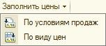
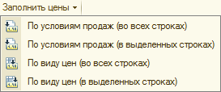
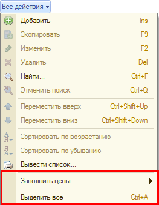
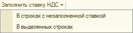

# #std695 Командные панели табличных частей

> Область применения: управляемое приложение.
>
> Раздел ИТС: Проектирование интерфейсов для 8.2 / Формы
>
> Источник: https://its.1c.ru/db/v8std/content/695/hdoc
>
> Проверено по источнику: 2026-10-07

*Этот стандарт распространяется на табличные части форм объектов и не распространяется на формы списков.*

Командная панель табличной части формы может содержать команды, применяемые:

· к табличной части в целом

· к отдельным строкам табличной части (одной или нескольким)

· к одной строке табличной части

1\. Команды, применяемые к табличной части в целом и к отдельным строкам табличной части

1.1. Команды, влияющие на заполнение отдельных строк, должны применяться исключительно к выделенным строкам. 

*Например, следует использовать одну команду "Заполнить по виду цен" вместо двух – "Заполнить по виду цен во всех строках" и "Заполнить по виду цен в выделенных строках":*

<table><tbody><tr><td style="background-color: transparent; vertical-align: top"> 
Правильно
</td><td style="background-color: transparent; vertical-align: top"> 
Неправильно
</td></tr>

<tr><td style="background-color: transparent; vertical-align: top"> 

</td><td style="background-color: transparent; vertical-align: top"> 

</td></tr></tbody></table>

1.2. При добавлении команды, влияющей на заполнение отдельных строк, в подменю "Все действия" следует добавлять команду "Выделить все". Это нужно делать в связи с тем, что многие пользователи не знакомы с горячими клавишами Ctrl+A.

*Например: команда "Выделить все" добавлена в подменю "Все действия" для того, чтобы можно было быстро заполнить цены не только в выделенных строках, но и во всех*

1.3. Допускается добавлять команды, которые будут действовать не на выделенные строки, а на строки, отобранные по специальному алгоритму. Это следует делать только для частотных операций, по которым пользователю сложно самостоятельно выделить строки.

*Например, команда для операции автоматического заполнения видов цен только по тем строкам, в которых вид цен не заполнен. *

1.4. Если в одной командной панели есть схожие команды, одна из которых действует на выделенные строки, а другая – на все, то из названия команд должно быть понятно, на какие именно строки они влияют.

*Например:*

### **См. также:**

<u>[Групповые обработки в списках](<https://its.1c.ru/db/v8std/content/653/hdoc>)</u>  

[Подменю](<https://its.1c.ru/db/v8std/content/694/hdoc>)
