# #std696 Формы пошаговых помощников (мастеров)

> Область применения: управляемое приложение.
>
> Раздел ИТС: Проектирование интерфейсов для 8.2 / Формы
>
> Источник: https://its.1c.ru/db/v8std/content/696/hdoc
>
> Проверено по источнику: 2026-10-07

Пошаговые помощники (мастера) используются для последовательного, контекстно-зависимого ввода данных. В помощнике весь процесс ввода данных разбивается на несколько отдельных этапов.

*Примеры пошаговых помощников:  помощник ввода нового партнера, помощник приема сотрудника на работу, помощник создания опроса, помощник обновления системы и т.д.*

1\. Расположение и оформление кнопок

1.1. Кнопки, которые используются в форме пошагового помощника, оформляются в виде командной панели, расположенной в нижней части формы. Подобное размещение командной панели характерно именно для форм помощников.

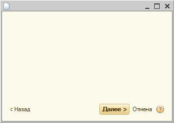

1.2. На каждом этапе помощника одна из кнопок должна являться кнопкой по умолчанию и отличаться от других кнопок визуально – желтым цветом фона и жирным шрифтом.

Для разных экранов помощника кнопка по умолчанию может называться по-разному.

Как правило, кнопка по умолчанию – это команда, наиболее часто используется на конкретном экране.

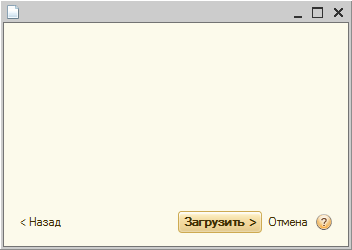

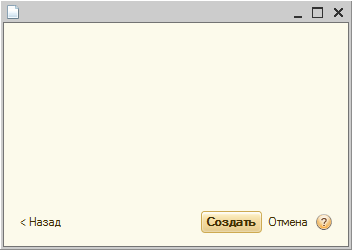

2\. Состав кнопок

2.1. Состав кнопок определяется для каждого помощника индивидуально и зависит от задач, которые решаются с помощью него.

Командная панель помощника может включать:

· Кнопку по умолчанию:

`o`"Далее"

`o`Кнопка, подтверждающая ввод данных

`o`"Закрыть"

· "Назад"

· "Отмена"

· "Справка"

2.2. **Кнопка «Далее»**

Используется для перехода к следующему этапу помощника.  В название кнопки добавляется угловая скобка "&gt;".

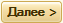

2.3. **Кнопка "Назад" (при наличии)**

Используется для перехода к предыдущему этапу помощника. В название кнопки добавляется угловая скобка "&lt;".

В командной панели кнопка "Назад" всегда располагается в крайнем левом углу. На первый экран помощника кнопка "Назад" не добавляется.

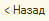

2.4. **Кнопка, подтверждающая ввод данных**

Используется для безусловного применения всех действий, выполненных в помощнике.

В качестве названия для этой кнопки следует использовать глагол, характеризующий действие, которое будет выполнено при нажатии на нее.

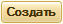

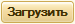

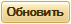

В случае если такое название подобрать сложно, можно использовать слово "Готово".

Название "ОК" лучше не использовать, т.к. пользователю будет сложнее попасть в кнопку из-за небольшого размера, а также понять, какое действие подразумевается под "ОК".

Если кнопка, подтверждающая ввод данных, расположена на одном из промежуточных экранов помощника, то в название кнопки добавляется угловая скобка "&gt;".

В случае расположения кнопки на последнем экране помощника, угловая скобка "&gt;" не добавляется.

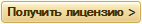

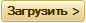

2.5. **Кнопка "Закрыть"**

После нажатия на кнопку, подтверждающую ввод данных, может быть показана информация, содержащая результаты выполнения операции (как положительные, так и отрицательные). Если эта информация выводится справочно, и от пользователя не требуется выполнять никаких дополнительных действий, то в качестве кнопки по умолчанию используется кнопка "Закрыть".

При нажатии на эту кнопку форма помощника закрывается.

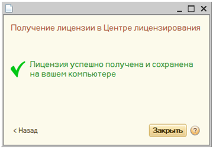

2.6. **Кнопка "Отмена" (при наличии)**

Позволяет пользователю отказаться от ввода данных и закрыть форму помощника. В случае если пользователь ввел какие-либо данные в форме, то при нажатии на кнопку "Отмена" следует выдавать сообщение с вопросом об их сохранении.

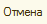

В командной панели кнопка "Отмена" располагается между кнопкой, подтверждающей ввод данных, и кнопкой "Справка".

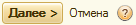

2.7. **Кнопка "Справка" (при наличии)**

Используется для отражения справочной информации по вводу данных в помощнике. Если подобной информации не предусмотрено, то кнопку "Справка" отражать не нужно.

В командной панели кнопка "Справка всегда располагается крайней справа.

