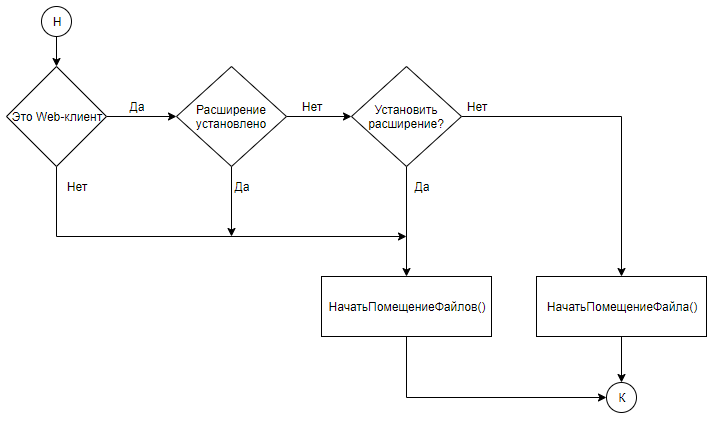
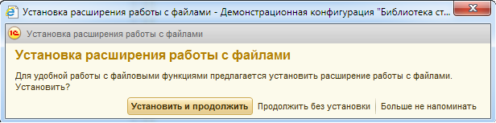

# #std700 Установка внешних компонент и расширений платформы

> Область применения: управляемое приложение.
>
> Раздел ИТС: Разработка пользовательских интерфейсов / Организация диалога с пользователем
>
> Источник: https://its.1c.ru/db/v8std/content/700/hdoc
>
> Проверено по источнику: 2026-10-07

<a id="1.1"></a>1.1. Установка внешних компонент и расширений платформы должна быть интерактивной. Пользователь должен самостоятельно принять решение об установке. В диалоге установки должно быть указано, для чего нужна компонента (расширение) и что не будет работать, если ее не устанавливать.

Например, неправильно использовать конструкции вида

```bsl
Если Не ПодключитьВнешнююКомпоненту(…) Тогда
  УстановитьВнешнююКомпоненту(…)
```

Правильно задавать пользователю вопрос в явном виде:

> *Для продолжения работы требуется установить внешнюю компоненту, которая позволит работать с отчетностью. Для установки компоненты нажмите "Установить". После завершения установки нажмите "Продолжить".*

<a id="1.2"></a>1.2. Рекомендуется выводить предложение об установки компоненты (расширения) перед выполнениям прикладного действия. <br>

Например:

- Пользователь воспользовался командой «Отправить отчет»

- Для этого конфигурации необходимо, чтобы была установлена какая-либо внешняя компонента.

- Конфигурация проверяет, установлена ли компонента.

- Если компонента не установлена, отображает пользователю информацию о том, что для отправки отчета нужно установить компоненту и кнопку, вызывающую установку компоненты.

- Пользователь нажимает на кнопку, выполняется установка.

- После установки пользователь нажимает на кнопку «Продолжить отправку отчета»

- Программа продолжает отправлять отчет.

Такой сценарий позволит обеспечить, чтобы компоненты (расширения) устанавливались без проблем на всех поддерживаемых браузерах, в том числе, в браузере **FireFox**.

Другой пример. Предложение об установке расширения работы с файлами при загрузке файла из файловой системы:



<a id="1.3"></a>1.3. При использовании в конфигурации **Библиотеки стандартных подсистем** для вывода предложения об установке расширения работы с файлами следует использовать следующие процедуры общего модуля **ФайловаяСистемаКлиент** в следующих сценариях:

- **ВыбратьКаталог** вместо метода **Показать** объекта **ДиалогВыбораФайла** с заданным режимом работы **ВыборКаталога**;

- **ЗагрузитьФайл** вместо методов глобального контекста **ПоместитьФайл**, **НачатьПомещениеФайла**, а также вместо метода **Показать** объекта **ДиалогВыбораФайла** с заданным режимом работы **Открытие**;

- **ЗагрузитьФайлы** вместо методов глобального контекста **ПоместитьФайлы**, **НачатьПомещениеФайлов**, а также вместо метода **Показать** объекта **ДиалогВыбораФайла** с заданным режимом работы **Открытие**;

- **ОткрытьФайл** вместо метода глобального контекста **ЗапуститьПриложение** для открытия файла, ассоциированного с некоторым приложением;

- **СохранитьФайл** вместо метода глобального контекста **ПолучитьФайл** или метода **Показать** объекта **ДиалогВыбораФайла** с заданным режимом работы **Сохранение**;

- **СохранитьФайлы** вместо методов глобального контекста **ПолучитьФайлы**, **НачатьПолучениеФайлов**, а также вместо метода **Показать** объекта **ДиалогВыбораФайла** с заданным режимом работы **Сохранение**.

- В остальных случаях, для вывода предложения об установке расширения работы с файлами следует использовать процедуру **ПодключитьРасширениеДляРаботыСФайлами**.<br>

    <br>

    

<br>

2\. В прикладном решении должны быть предоставлены функции для установки пользователем внешних компонент и расширений в любой момент работы. Таким образом, их можно установить не только в ходе решения какой-то задачи, но и в виде отдельного действия (из формы персональных или административных настроек).

### См. также

- [Общие требования к конфигурации](<https://its.1c.ru/db/v8std/content/467/hdoc>) <br>

     <br>
