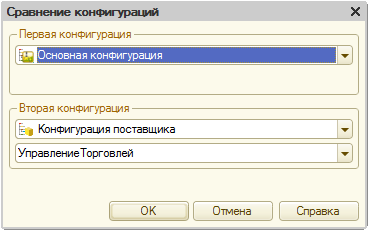
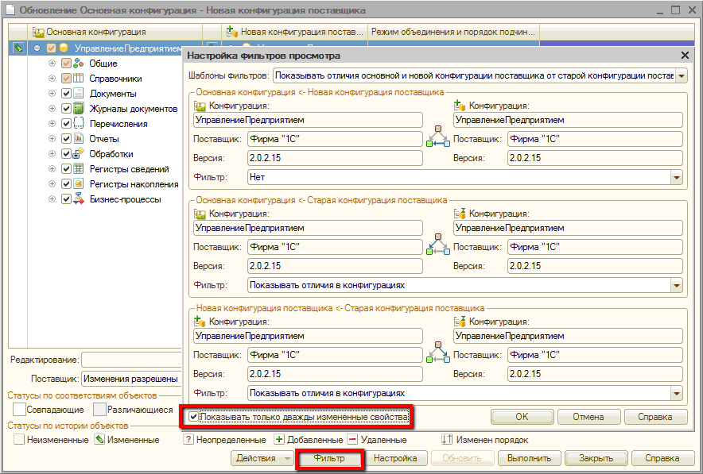
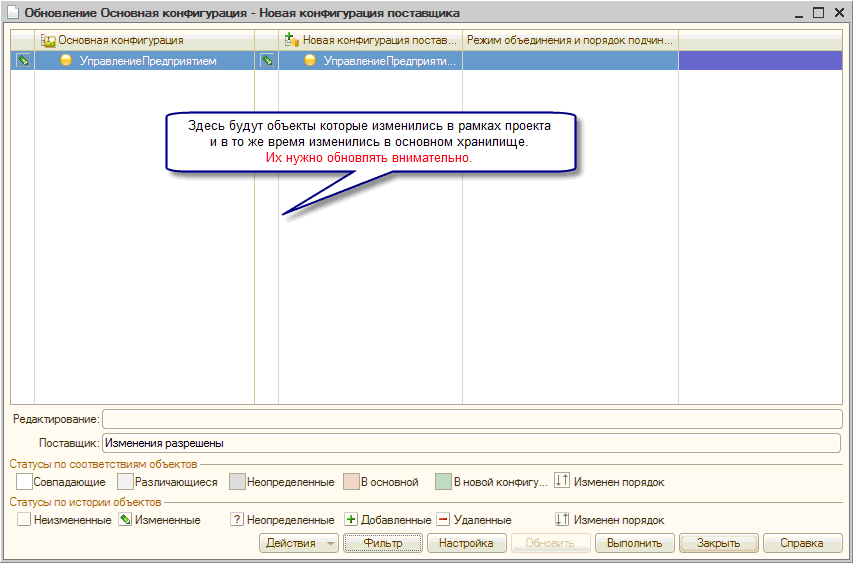
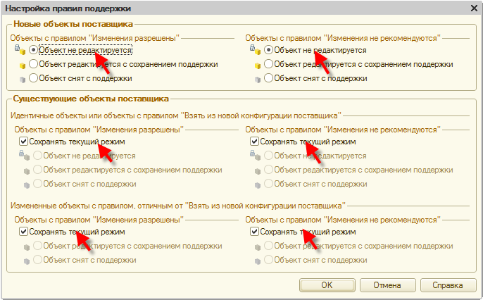
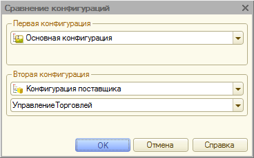

# #std709 Технология разветвленной разработки конфигураций

> Область применения: управляемое приложение, мобильное приложение, обычное приложение.
>
> Раздел ИТС: Создание и изменение объектов метаданных / Организация работы конфигурации
>
> Источник: https://its.1c.ru/db/v8std/content/709/hdoc
>
> Проверено по источнику: 2026-10-07

*Методическая рекомендация (полезный совет)*

Цели внедрения технологии:

- Повышение качества разрабатываемой конфигурации

- Повышение культуры разработки и тестирования

- Обеспечение непрерывного развития конфигураций в условиях жестких сроков разработки

## 1\. Определения

**Плановая версия конфигурации** – версия, содержащая существенное развитие функциональности, срок выпуска которой назначается заранее. 

 

**Исправительная версия** – версия, которая выпускается при необходимости срочной публикации исправлений критичных ошибок. В исключительных случаях исправительная версия может содержать какую-то новую функциональность (например, доработки, связанные с поддержкой изменения законодательства). Срок выпуска определяется при анализе количества и критичности обнаруженных ошибок плановой версии. 

 

**Технический проект** – задание на доработку конфигурации. Каждый технический проект имеет четко сформулированную цель и конечный список изменений, которые нужно выполнить, чтобы достигнуть этой цели.

Для организации работ по разработке и сопровождению конфигураций (в т.ч. ведению информации о технических проектах и списка ошибок) рекомендутся использовать **Систему проектирования прикладных решений (СППР)**.

## 2\. Разработка исправительных версий

2.1. Для выпуска каждой исправительной версии создается новое хранилище на основе конфигурации последней выпущенной версии. 

 

Важно – нужно создавать новое хранилище, а не копировать основное!

2.2. В исправительной версии не должно быть объемных доработок конфигурации, в противном случае нужно пересматривать сроки выпуска плановой версии.

2.3. Все закладки в хранилище исправительной версии должны содержать комментарий. 

 

Требования к содержанию комментариев аналогичны требованиям к закладкам в хранилище плановой версии (см. п.3.4).

2.4. Все изменения, которые выполняются в исправительном релизе, должны синхронно повторяться в основном хранилище. Если в исправительном релизе добавляются новые объекты (реквизиты объектов), то переносить изменения нужно исключительно с помощью сравнения/объединения конфигураций, для того чтобы не различались внутренние идентификаторы объектов конфигурации.

2.5. При сборке исправительной версии рекомендуется устанавливать метку с информацией о номере сборки на закладке той версии хранилища, конфигурация которой идет в сборку. Обычно это последняя на момент сборки закладка.

## 3\. Разработка плановой версии

3.1. Разработка плановых версий ведется в основном хранилище конфигурации.

3.2. Закладки в основное хранилище должны осуществляться таким образом, чтобы каждая закладка переводила конфигурацию хранилища из одного рабочего (готового к выпуску) состояния в другое.  

**Не допускается закладка не полностью отлаженной функциональности.** Основное хранилище всегда должно находиться в «неразваленном» состоянии, чтобы в любой момент можно быть начать сборку плановой версии.

3.3. В основном хранилище разрешается выполнять следующие работы:

- исправление ошибок, не требующих перепроектирования, объемного кодирования и тестирования. Если ошибка требует больших переработок и/или пересмотра проектных решений, то исправление такой ошибки должно вестись в рамках технического проекта. Порядок работы с основным хранилищем должен быть таким же, как и по другим техническим проектам;

- встраивание новых версий библиотек;

- встраивание полностью отлаженных, прошедших отладочное тестирование проектов;

- в исключительных случаях в основном хранилище может вестись разработка некоторых проектов, (например, проектов по массовому рефакторингу).

Рекомендуется использовать реализованные в **СППР** возможности автоматической генерации текстов комментариев для закладок, связанных с исправлением ошибок и встраиванием технических проектов.

3.4. Все закладки в основное хранилище должны содержать комментарий. 

 

Содержание комментария зависит от характера выполненных работ:

- при исправлении ошибки обязательно должен быть указан номер и краткое наименование ошибки в системе баг-трекинга;

- при встраивании новой версии библиотеки должно быть указано название библиотеки и точный номер версии библиотеки;

- при встраивании технических проектов – номер проекта в системе ведения проектной документации, а также краткое наименование;

- при выполнении работ по техническому проекту в основном хранилище комментарий, помимо номера и краткого наименования проекта, должен содержать краткое описание сделанных в этой закладке изменений.

3.5. Все изменения по техническому проекту должны переноситься в основное хранилище за одну закладку. Если необходимо переносить изменения несколько раз, то нужно открывать несколько проектов.

3.6. После переноса изменений в основном хранилище можно исправлять ошибки, наведенные техническим проектом. Для пересмотра проектных решений нужно открывать новый проект.

3.7. При сборке плановой версии рекомендуется устанавливать метку с информацией о номере сборки на закладке той версии хранилища, конфигурация которой идет в сборку. Обычно это последняя на момент сборки закладка.

## 4\. Разработка технических проектов

4.1. Разработка каждого технического проекта ведется в отдельном хранилище.  

 

При использовании **СППР** хранилище технического проекта может быть созданно автоматически. Если **СППР** не используется, хранилище технического проекта нужно будет создавать вручную, в соотвествии с порядком, описанном в Приложении 1.

4.2. При постановке хранилища технического проекта на поддержку от основного хранилища, платформа для всех объектов устанавливает правило «Объект поставщика, не редактируется». Для работы над техническим проектом нужно изменить это правило на «Объект поставщика редактируется с сохранением поддержки». 

 

Правило «Объект поставщика редактируется с сохранением поддержки» нужно устанавливать только для тех объектов, которые изменяются при выполнении технического проекта. Правило нужно менять как можно более точечно – например, если изменения в проекте будут затрагивать только форму, то нужно изменить правило только для этой формы, а для объекта, которому эта форма принадлежит, нужно оставить правило «Объект поставщика, не редактируется».  

 

Для изменения правил поддержки нужно захватить только корень конфигурации, захватывать сами объекты не нужно. 

 

Выполнение этих рекомендаций позволит упростить процесс переноса изменений между основным хранилищем и хранилищем тех. проекта.

4.3. Ответственный за технический проект может периодически обновлять конфигурацию хранилища проекта. Периодичность обновления разработчик определяет самостоятельно. 

 

На частоту обновления могут влиять следующие факторы:

- затрагивает ли технический проект объекты других ответственных;

- проводится ли в данное время рефакторинг общих механизмов;

- ведется ли сейчас в основном хранилище массовое исправление ошибок.

Порядок обновления хранилища технического проекта описан в приложении 2.

4.4. После окончания разработки ответственный согласует сроки завершения отладочного тестирования и сроки внесения технического проекта в основное хранилище. Проекты, затрагивающие большое количество объектов рекомендуется вноситься в основное хранилище ближе к сроку окончания разработки, чтобы уменьшить влияние на другие проекты.  

 

Ответственные за другие технические проекты могут попросить перенести сроки внесения в основное хранилище.

В **СППР** согласовывать сроки встраивания технических проектов можно, используя функциональность контрольных точек по техническому проекту.

4.5. Внесение проекта в основное хранилище должно осуществляться после завершения отладочного тестирования. Рекомендуется по окончании исправления ошибок, выявленных отладочным тестированием технического проекта, сформировать файл сравнения конфигурации проекта и конфигурации основного хранилища.

4.6. Внесение наработок технического проекта в основное хранилище не должно проводить к длительному захвату объектов основного хранилища. Это достигается тем, что сначала хранилище технического проекта обновляется до состояния основного хранилища (по методике, описанной в приложении 2). Если изменений много, то такое обновление может занять достаточно много времени (до нескольких дней) – за это время конфигурация основного хранилища может измениться. Поэтому процесс обновления может быть итеративным – на каждой итерации обновления отличия в конфигурациях будут становиться все ближе к величине изменений, внесенных техническим проектом.  

 

После каждой итерации обновления целесообразно проводить быструю проверку работоспособности функциональности, разрабатываемой в рамках проекта. 

 

Начинать перенос изменений в основное хранилище (захватывать объекты в основном хранилище) следует только тогда, когда конфигурация технического проекта будет отличаться от конфигурации основного хранилища практически только на изменения, вносимые проектом.

4.7. Ответственный за технический проект должен внимательно относиться к внесению изменений в основное хранилище. Нужно помнить, что основное хранилище должно в любой момент времени находиться в состоянии готовности к выпуску плановой версии. 

 

После внесения изменений в основное хранилище разработчики технического проекта совместно с тестировщиками проводят быструю проверку того, что изменения перенесены корректно и не повлияли на работоспособность смежной функциональности. Объем проверок и порядок их проведения определяет ответственный за проект.

4.8. После проверки переноса изменений и до закладки изменений в основное хранилище, ответственный обязательно должен запустить проверку конфигурации. Проверку нужно проводить с максимальными настройками. 

Закладка изменений в основное хранилище допускается только после того, как будут исправлены все ошибки, выявленные проверкой конфигурацией, которые были привнесены проектом.

4.9. После переноса изменений в основное хранилище ответственный за технический проект удаляет хранилище проекта

## 5\. Нумерация сборок

Изменение номеров версий регламентируется стандартом [Нумерация редакций и версий](<https://its.1c.ru/db/v8std/content/483/hdoc>) 

Здесь будут уточнены правила изменения номера сборки (четвертое число в номере версии)

5.1. Номер сборки следует увеличивать как в основном хранилище, так и в хранилище исправительного релиза в двух случаях:

- непосредственно перед сборкой релиза. Это необходимо, чтобы полный номер собранного релиза гарантированно отличался от полного номера предыдущего релиза;

- при закладке в хранилище обработчика обновления информационной базы. Это необходимо, чтобы после обновления из хранилища у всех участников разработки добавленный обработчик обновления запускался автоматически (только для конфигураций, основанных на **Библиотеке Стандартных Подсистем**).

5.2.1. При добавлении в хранилище обработчиков обновления информационной базы рекомендуется в рамках этой же закладки повышать номер сборки. Существует два возможных сценария:

- Обработчик обновления добавляется при разработке технического проекта в хранилище технического проекта. В этом случае при переносе изменений в основное хранилище следует увеличить номер сборки основного хранилища.

- Обработчик обновления добавляется в рамках исправления ошибки. Если ошибка исправляется только в одном хранилище (основном или исправительном), то номер сборки повышается только в нем, если в двух – значит нужно увеличить номер в обоих хранилищах.

5.2.2. Обработчик и изменение номера сборки должны помещаться в хранилище в рамках одной закладки. При этом обработчик обновления должен быть «привязан» к тому номеру сборки, который вместе с ним помещается в хранилище.

5.2.3. Если в рамках одной конфигурации обработчики обновления разбиты по технологическим подсистемам (например, в конфигурации **1С:ERP** обработчики разбиты на подсистемы УправлениеПредприятием и УправлениеТорговлей), то нужно повышать номер сборки как подсистемы, к которой относится обработчик, так и конфигурации.

5.3. Номер сборки необходимо изменять:

1. В свойствах конфигурации.

2. В процедуре ОбновлениеИнформационнойБазы&lt;ИмяБиблиотеки&gt;.ПриДобавленииПодсистемы (только для конфигураций, основанных на **Библиотеке Стандартных Подсистем**).

## Приложение 1. Порядок создания хранилища технического проекта

1. Обновить из хранилища конфигурацию информационной базы, подключенную к основному хранилищу 

2. Создать файл поставки конфигурации основного хранилища (\*.cf) 

3. В информационную базу, которая будет использоваться для работы над техническим проектом, **загрузить** конфигурацию из файла поставки. После загрузки конфигурации из файла поставки конфигурация будет находиться на поддержке без возможности изменения. 

4. Создать хранилище конфигурации в соответствующей общей папке (при создании хранилища платформа включит в конфигурации возможность изменения) 

5. Добавить пользователя ТолькоПросмотр (без пароля, без права захвата объектов). Этого пользователя не нужно использовать для подключения базы к хранилищу – только для обновления из хранилища (получения конфигурации хранилища) 

6. Добавить в хранилище пользователей, перечисленных в проекте (логин – фамилия сотрудника, без пароля, с правом захвата объектов). Не нужно использовать для работы участников проекта логин пользователя ТолькоПросмотр.

## Приложение 2. Порядок обновления хранилища технического проекта до состояния основного хранилища

Перед выполнением переноса изменений из *хранилища технического проекта* (далее ХТП) в *основное хранилище* (далее ОХ) выполняется обновление ХТП до состояния ОХ. 

 

Для того чтобы обновить ХТП до состояния ОХ необходимо выполнить следующее:

1. Обновить информационную базу, подключенную к ОХ. 

2. Создать файл поставки конфигурации ОХ. 

3. Захватить все объекты в ХТП. 

4. Запустить сравнение основной конфигурации и конфигурации поставщика (Конфигурация – Сравнить конфигурации). Результаты сравнения сохранить в файл – это изменения, внесенные в конфигурацию при работе над техническим проектом. В меню «Действия» выбрать пункт «Отчет о сравнении конфигураций». Для дальнейшего использования лучше вывести и сохранить отчет о сравнении и в текстовом формате и формате табличного документа. 

     

    

     
5. Обновить конфигурацию (Конфигурация – Поддержка – Обновить конфигурацию – Выбор файла обновления – указать файл поставки конфигурации созданный на шаге 2). 

     

    В появившемся окне сравнения и объединения конфигураций нажать кнопку "Фильтр" и установить флажок Показывать только дважды измененные свойства". 

     

    

     

     

    На эти объекты нужно обратить внимание при объединении, остальные изменения можно объединять без проверки. 

     

    

     
6. В диалоге, который появляется при нажатии на кнопку «Выполнить» окна сравнения и объединения конфигураций, для новых объектов поставщика нужно установить правило «Объект не редактируется» - как для объектов с правилом «Изменения разрешены» так и для объектов с правилом «Изменения не рекомендуются», для всех остальных установить флаг «Сохранять текущий режим» (по умолчанию он установлен). 

     

    

     
7. После завершения объединения нужно исправить объекты, затрагиваемые техническим проектом, изменения в которых затерлись при обновлении. По сути это означает, что нужно выполнить повторное внесение доработок, реализованных в рамках технического проекта в объекты конфигурации. 

8. Запустить сравнение обновленной основной конфигурации технического проекта и обновленной конфигурации поставщика (Конфигурация – Сравнить конфигурации) 

     

    

     
9. Результаты сравнения сохранить в файл, имя файла должно отличаться от имени файла созданного на шаге 6. В меню «Действия» выбрать пункт «Отчет о сравнении конфигураций». Для дальнейшего использования лучше вывести и сохранить отчет о сравнении в текстовом формате. 

10. Сравнить файлы, созданные на шаге 4 и шаге 9. При правильном обновлении, сравнение файлов не должно показать отличий.
