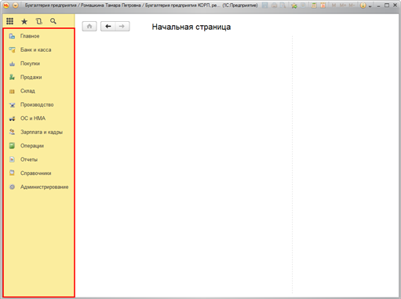
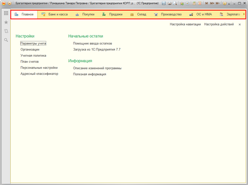

# #std712 Панель разделов

> Область применения: управляемое приложение.
>
> Раздел ИТС: Проектирование интерфейсов для 8.3 / Командный интерфейс
>
> Источник: https://its.1c.ru/db/v8std/content/712/hdoc
>
> Проверено по источнику: 2026-10-07

Панель разделов может выводиться как в виде отдельной панели, так и в составе меню функций:

# 1\. Состав панели

Панель разделов является "лицом" программы и имеет большое значение на этапе освоения, поэтому состав и порядок разделов следует проектировать с особой тщательностью. Количество и состав разделов должен соответствовать реальным участкам работ и областям деятельности так, как их видят пользователи.

1.1. Раздел "Главное" по умолчанию присутствует во всех конфигурациях и располагается первым. В него рекомендуется добавлять команды перехода к объектам, относящимся ко всей конфигурации, и не включать объекты, относящиеся к конкретным разделам учета или областям деятельности.

1.2. Списки с условно-постоянной информацией (справочники, регистры сведений, списки перечислений и другие), в командном интерфейсе можно размещать:

· внутри раздела, с которым связан такой список (в конце меню или в "См. также") 

Например, список должностей в разделе Кадры

· в специально выделенном разделе конфигурации. При этом в других разделах команды перехода к подобным спискам, как правило, не размещаются 

Например, разделы "Справочники", "Настройки", "НСИ".

· в панели навигации формы списка с условно-постоянной информацией, которой они "подчинены" 

Например, "Счета учета номенклатуры" в панели навигации справочника "Номенклатура"

Исключение составляют списки с условно-постоянной информацией, с которых начинаются бизнес-процессы. Такие списки рекомендуется помещать в группы меню соответствующего раздела.

Например, справочник "Сотрудники" размещается в разделе "Кадры", потому что сначала в него вводится информация о работнике, а потом на основании этих данных создается приказ о приеме на работу и другие документы.

1.3. Разделы для настройки, администрирования и выполнения сервисных действий следует располагать в конце панели.

# 2\. Названия разделов

2.1. Общая длина названия раздела не должна превышать 35 знаков с учетом пробелов (это позволяет разместить название в 2 строки, при дальнейшем увеличении количества знаков появится многоточие). Лучше выбирать названия примерно одного размеры по ширине, чтобы они смотрелись единообразно и ровно.

2.2. Старайтесь сделать названия разделов конкретными и запоминающимися. Назначение раздела должно быть понятно из его названия.

2.3. По возможности не используйте длинные слова. При выборе названия рекомендуется комбинировать слова следующим образом:

<table><tbody><tr><td style="background-color: #f3f3f3; vertical-align: top"> 
Комбинация слов
</td><td style="background-color: #f3f3f3; vertical-align: top"> 
Пример
</td></tr>

<tr><td style="background-color: transparent; vertical-align: top"> 
Одно-два средних слова
</td><td style="background-color: transparent; vertical-align: top"> 
Продажи
 
Зарплата и персонал
</td></tr>

<tr><td style="background-color: transparent; vertical-align: top"> 
Одно длинное и одно короткое
</td><td style="background-color: transparent; vertical-align: top"> 
Отчетность и справки 
</td></tr>

<tr><td style="background-color: transparent; vertical-align: top"> 
 
 
Два коротких и одно длинное
</td><td style="background-color: transparent; vertical-align: top"> 
 
 
Учет, налоги, отчетность
</td></tr></tbody></table>

2.4. Используйте в названиях только общеупотребительные и соответствующие целевой аудитории сокращения и аббревиатуры.

Например, "НДС" или "МСФО".

При этом сокращение обязательно нужно расшифровать во всплывающей подсказке.

Например, для названия раздела "ОС и НМА" появляется всплывающая подсказка "Основные средства и нематериальные активы"

2.5. Не рекомендуется делать раздел с названием "Сервис", т.к. он будет перекликаться с пунктом "Сервис" главного меню и группой "Сервис" в панели / меню функций

# 3\. Картинки разделов

3.1. Названия разделов рекомендуется выводить в режиме "Картинка и текст"

3.2. Картинки следует делать разными по начертанию и ведущим цветам для лучшей запоминаемости. Но при этом они должны быть нарисованы в одном стиле, с одинаковым направлением света. Картинки должны быть нарисованы во фронтальной плоскости проекции

См. также:

[Панель разделов (8.2)](<https://its.1c.ru/db/v8std/content/567/hdoc>)

[Названия разделов (8.2)](<https://its.1c.ru/db/v8std/content/568/hdoc>)

[Картинки разделов (8.2)](<https://its.1c.ru/db/v8std/content/569/hdoc>)

[Подсказки для интерфейсных подсистем (8.2)](<https://its.1c.ru/db/v8std/content/571/hdoc>)
