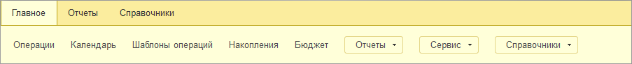
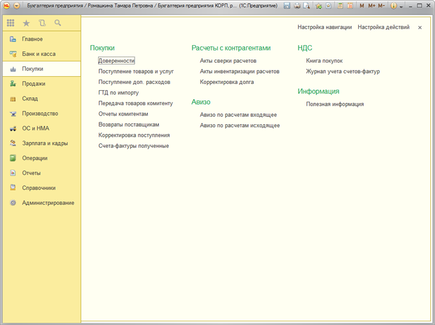
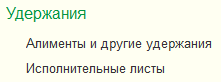
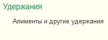
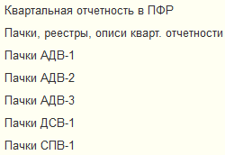
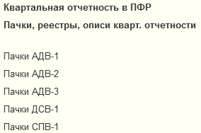
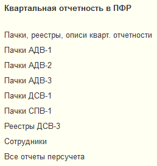
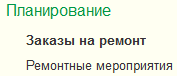
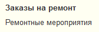

# #std714 Навигация внутри раздела

> Область применения: управляемое приложение.
>
> Раздел ИТС: Проектирование интерфейсов для 8.3 / Командный интерфейс
>
> Источник: https://its.1c.ru/db/v8std/content/714/hdoc
>
> Проверено по источнику: 2026-10-07

Навигация внутри конкретного раздела осуществляется с помощью "Панели функций текущего раздела" или области навигации и действий в составе "Меню функций"

Панель функций текущего раздела

Панель функций текущего раздела рекомендуется использовать в конфигурациях, содержащих небольшое количество команд в каждом разделе. В конфигурациях со сложной структурой и большим количеством команд эту панель рекомендуется скрывать.

Область команд навигации и действий в составе "Меню функций"

Область команд навигации и действий показывает все функциональные возможности раздела. В отличие от панели функций текущего раздела, команды здесь можно группировать.

# 1\. Состав команд

1.1. В раздел рекомендуется помещать команды перехода к:

· спискам и журналам документов

· спискам "первичных" документов (данных), с которых начинаются бизнес-процессы

· рабочим местам

· специальным обработкам, похожим на обычные списки

· отчетам

При этом все эти команды должны решать задачу по конкретному участку работ или области деятельности.

1.2. Второстепенные и подчиненные другим объекты можно не выносить в командный интерфейс.

Чаще всего это справочники и регистры сведений, доступ к которым можно получить из документов или других объектов.

Например:

<table><tbody><tr><td style="background-color: #f3f3f3; vertical-align: top"> 
Справочники "Контрагенты", "Договоры" выносятся в командный интерфейс:
</td><td style="background-color: #f3f3f3; vertical-align: top"> 
Справочник "Причины списания основного средства" не выносится в командный интерфейс:
</td></tr>

<tr><td style="background-color: transparent; vertical-align: top"> 
- эти справочники открываются из разных документов, но они могут использоваться и без привязки к документам, например, для просмотра контактной информации по контрагенту или условий оплаты по договору
 
- справочники могут содержать много элементов, может потребоваться работа с их списком. Например, поиск договоров по статусу или периоду, удаление дубликатов контрагентов
</td><td style="background-color: transparent; vertical-align: top"> 
- этот справочник можно открыть из одного специализированного документа "Списание основного средства"
 
- элементов этого справочника мало и они редко изменяются, у пользователя нет необходимости просматривать список этих элементов в отрыве от контекста
</td></tr></tbody></table>

# 2\. Названия команд

2.1. Чтобы при стандартном разрешении экрана не возникало полос прокрутки, рекомендуется следить, чтобы названия команд не превышали 38 символов, а лучше – умещались в 30.

# 3\. Группировка команд

3.1. Область команд включает в себя блок с командами навигации и блок с командами действий, но для пользователя все они выглядят одинаково. Поэтому при группировке следует объединять команды не по техническим признакам (вид объекта; действие, происходящее при выборе команды), а по тому, как их структурирует пользователь в своей работе.

3.2. В одну группу рекомендуется включать не более 7 команд.

3.3. Не рекомендуется делать группы, содержащие всего одну команду.

<table><tbody><tr><td style="background-color: transparent; vertical-align: top"> 
Правильно
</td><td style="background-color: transparent; vertical-align: top"> 
Неправильно
</td></tr>

<tr><td style="background-color: transparent; vertical-align: top"> 
 
 

 
 
</td><td style="background-color: transparent; vertical-align: top"> 
 
 

</td></tr></tbody></table>

Запрещается делать группы, в которых выводится только одна "важная" команда.

<table><tbody><tr><td style="background-color: transparent; vertical-align: top"> 
Правильно
</td><td style="background-color: transparent; vertical-align: top"> 
Неправильно
</td></tr>

<tr><td style="background-color: transparent; vertical-align: top"> 
 
 

 
 
 
или
 
 
 

 
 
</td><td style="background-color: transparent; vertical-align: top"> 
 
 

</td></tr></tbody></table>

3.4. Группам рекомендуется добавлять название. При этом оно не должно пересекаться с названиями системных групп ("Создать", "Отчеты", "Сервис", "Важное", "См. также"). Обязательно нужно добавлять заголовок для групп, состоящих из нескольких команд и содержащих только одну важную.

<table><tbody><tr><td style="background-color: transparent; vertical-align: top"> 
Правильно
</td><td style="background-color: transparent; vertical-align: top"> 
Неправильно
</td></tr>

<tr><td style="background-color: transparent; vertical-align: top"> 
 
 

 
 
</td><td style="background-color: transparent; vertical-align: top"> 
 
 
 
 

</td></tr></tbody></table>

См. также:

[Панель навигации основного окна (8.2)](<https://its.1c.ru/db/v8std/content/572/hdoc>)

[Порядок и названия команд в ПН (8.2)](<https://its.1c.ru/db/v8std/content/573/hdoc>)

[Группа команд «Важное» в ПН (8.2)](<https://its.1c.ru/db/v8std/content/623/hdoc>)

[Группировка команд в ПН (8.2)](<https://its.1c.ru/db/v8std/content/574/hdoc>)

[Группа «См. также» в ПН (8.2)](<https://its.1c.ru/db/v8std/content/601/hdoc>)

[Команды, размещаемые в ПН (8.2)](<https://its.1c.ru/db/v8std/content/575/hdoc>)

[Панель действий (8.2)](<https://its.1c.ru/db/v8std/content/576/hdoc>)
