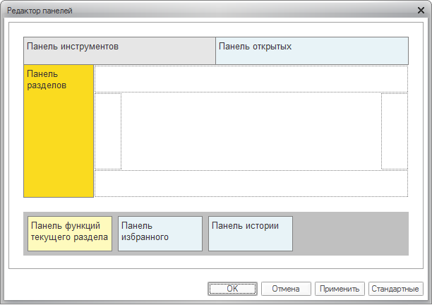
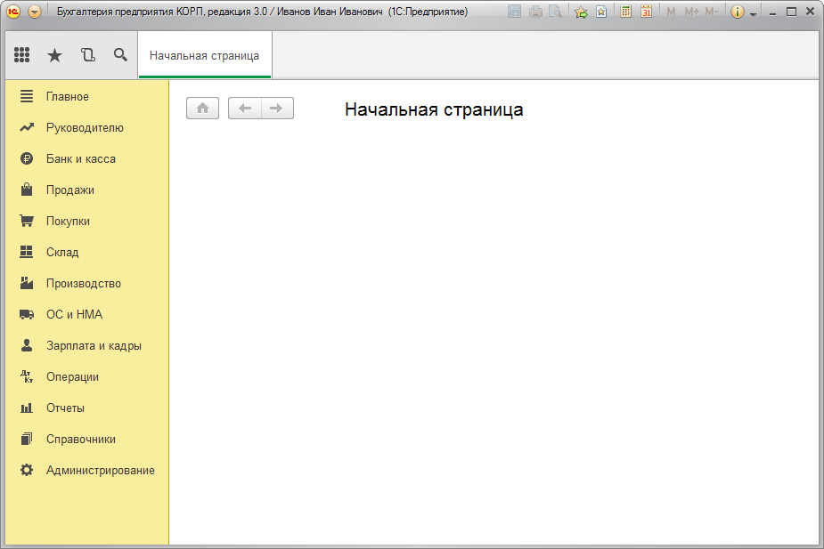

# #std715 Как вместить большое количество команд

> Область применения: управляемое приложение.
>
> Раздел ИТС: Проектирование интерфейсов для 8.3 / Командный интерфейс
>
> Источник: https://its.1c.ru/db/v8std/content/715/hdoc
>
> Проверено по источнику: 2026-10-07

В конфигурациях со сложной структурой меню и большим количеством команд рекомендуется:

1\. Панель разделов размещать вертикально, в левой части окна

2\. Заголовки разделов выводить в виде "Картинка и текст", использовать картинки размером 16х16

3\. Панель инструментов и панель открытых выводить сверху

4\. Панель функций текущего раздела не отображать. Навигация внутри раздела будет осуществляться с помощью Меню функций

