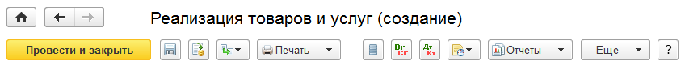
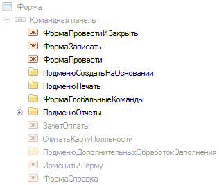

# #std716 Командная панель документа

> Область применения: управляемое приложение.
>
> Раздел ИТС: Проектирование интерфейсов для 8.3 / Формы документов
>
> Источник: https://its.1c.ru/db/v8std/content/716/hdoc
>
> Проверено по источнику: 2026-10-07

1\. В командной панели кнопка по умолчанию должна быть расположена самой крайней слева. В подавляющем большинстве случаев кнопкой по умолчанию является "Провести и закрыть" или "Записать и закрыть"

2\. Порядок расположения команд во всех документах должен быть одинаковым.

3\. Состав системных кнопок командной панели, отображаемых платформой по умолчанию, и их порядок относительно друг друга изменять не рекомендуется.

4\. Командная панель должна позволять пользователю при стандартных настройках экрана (ширина экрана 1280 точек, панель инструментов выведена слева вертикально) выполнить самые важные и частотные действия с документом, не открывая подменю "Еще".

5\. При стандартных настройках экрана пользователю должны быть сразу видны все важные команды:

\- Провести и закрыть / Записать и закрыть

\- Записать

\- Провести

\- Создать на основании

\- Печать

\- Глобальные команды

\- Дополнительные сведения

\- Движения документа

\- и т.д.

\- Отчеты (контекстные, из панели навигации)

6\. Если в командной панели расположено большое количество команд, рекомендуется отображать важные команды кнопками с картинками без текста.

Например, командная панель документа "Реализация товаров и услуг":

В Конфигураторе элементы командной панели структурируются следующим образом:

Команда "Записать" — свойство Отображение = Картинка

Команда "Провести" — свойство Отображение = Картинка

Подменю "Создать на основании" — свойство Отображение = Картинка

Подменю "Печать" — свойство Отображение = Авто

Подменю "Отчеты" — свойство Отображение = Авто

**См. также:** [Командная панель формы (8.2)](<https://its.1c.ru/db/v8std/content/620/hdoc>)
