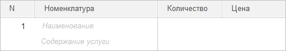
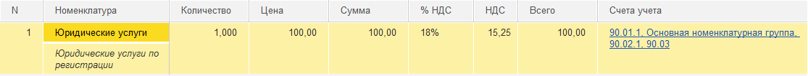
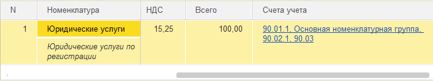

# #std717 Табличные части. Оформление списка

> Область применения: управляемое приложение.
>
> Раздел ИТС: Проектирование интерфейсов для 8.3 / Формы документов
>
> Источник: https://its.1c.ru/db/v8std/content/717/hdoc
>
> Проверено по источнику: 2026-10-07

1\. Шапка табличной части должна состоять из одной строки и для "одноэтажных" списков, и для "многоэтажных".

В "многоэтажных" колонках следует предусмотреть общий заголовок, соответствующий смыслу указываемых в них данных, а также отображение подсказки в ячейках с незаполненными значениями.

Для отображения подсказки следует одновременно использовать:

\- элемент стиля вида шрифт "ПодсказкаНезаполненнойЯчейки" (размер: 8, начертание: наклонный)

\- свойство "ПодсказкаВвода"

Например, для реквизитов с кратким и полным названиями номенклатуры выводится общий заголовок колонки – "Номенклатура", а в ячейках выводятся подсказки:

В Конфигураторе отображение заголовков колонок в шапке отключается с помощью свойства "ОтображатьВШапке"

2\. Заголовок колонки должен полностью помещаться в шапку

3\. Если в табличной части много колонок и они заведомо не помещаются при стандартном разрешении экрана без горизонтальной прокрутки, то часть из них следует расположить первыми и зафиксировать.

Фиксировать нужно самые важные колонки, которые позволят идентифицировать объект. Колонка с номером по порядку также фиксируется.

Например, для списка сотрудников фиксируется колонка "ФИО", для списка товаров и услуг – колонка "Номенклатура", для списка основных средств – наименование основного средства.

Все остальные реквизиты будут находиться в области, скроллируемой горизонтально.

Например:

В Конфигураторе фиксация колонки табличной части осуществляется с помощью свойства "ФиксацияВТаблице" (=лево)

4\. Колонкам, предназначенным для указания цифровых значений, рекомендуется явно указывать ширину, достаточную для указания наиболее частотных значений. При необходимости большей ширины пользователь сможет расширить колонку самостоятельно.

Например, для бухгалтерских документов в большинстве ситуаций достаточно ширины 10 (эта ширина позволяет указывать суммы в несколько млн руб.). 
