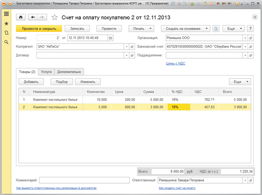
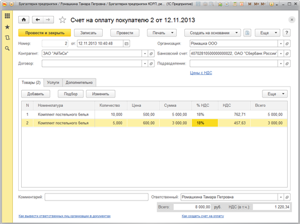
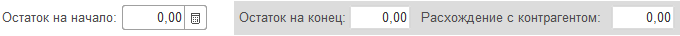
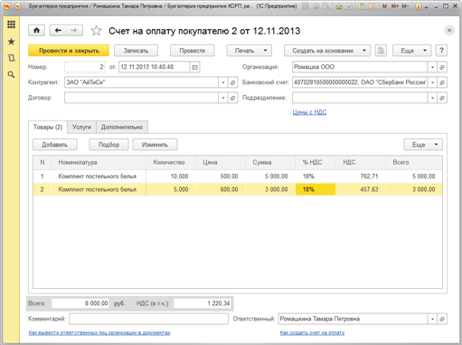
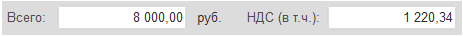
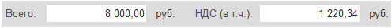

# #std718 Итоги в документах

> Область применения: управляемое приложение.
>
> Раздел ИТС: Проектирование интерфейсов для 8.3 / Формы документов
>
> Источник: https://its.1c.ru/db/v8std/content/718/hdoc
>
> Проверено по источнику: 2026-10-07

Итоги в документах можно выводить несколькими способами:

· отдельными полями ввода

· в подвалах таблиц

# 1\. Итоги в виде отдельных полей ввода

**Расположение**

1.1. Итоги размещаются сразу под таблицей (или несколькими таблицами), по которым они выводятся. Не следует вставлять элементы, разделяющие табличную часть и группу с итогами.

<table><tbody><tr><td style="background-color: transparent; vertical-align: top"> 
Правильно
</td><td style="background-color: transparent; vertical-align: top"> 
Неправильно
</td></tr>

<tr><td style="background-color: transparent; vertical-align: top"> 

</td><td style="background-color: transparent; vertical-align: top"> 

</td></tr></tbody></table>

1.2. В области итогов следует размещать только те элементы, которые относятся к итоговым данным. Иные элементы следует располагать вне области итогов.

Например, в форме "Акта сверки расчетов" реквизит "Остаток на начало" не является итоговым значением, а приводится информационно. Поэтому его не следует включать в группу с итогами и выделять серым фоном.

<table><tbody><tr><td style="background-color: transparent; vertical-align: top"> 
Правильно
</td></tr>

<tr><td style="background-color: transparent; vertical-align: top"> 

</td></tr>

<tr><td style="background-color: transparent; vertical-align: top"> 
Неправильно
</td></tr>

<tr><td style="background-color: transparent; vertical-align: top"> 

</td></tr></tbody></table>

1.3. Область с итогами выравнивается по правому краю формы

<table><tbody><tr><td style="background-color: transparent; vertical-align: top"> 
Правильно
</td><td style="background-color: transparent; vertical-align: top"> 
Неправильно
</td></tr>

<tr><td style="background-color: transparent; vertical-align: top"> 

</td><td style="background-color: transparent; vertical-align: top"> 

</td></tr></tbody></table>

**Оформление**

1.4. Итоги выделяются серым фоном. Для этого используется элемент стиля "ИтогиФонГруппы" (RGB 220,220,220)

1.5. Итоги оформляются отдельными полями ввода с установленным признаком «ТолькоПросмотр»

1.6. В заголовках полей текст выводится без слова «итог»

1.7. Валюта (в случае отражения) выводится после поля ввода. Если итоги включают в себя несколько взаимосвязанных полей, то валюта выводится только после первого из них. 

Например, в области итогов, содержащих взаимосвязанные поля "Всего" и "НДС (в т.ч.)" валюта выводится только после поля "Всего".

<table><tbody><tr><td style="background-color: transparent; vertical-align: top"> 
Правильно
</td><td style="background-color: transparent; vertical-align: top"> 
Неправильно
</td></tr>

<tr><td style="background-color: transparent; vertical-align: top"> 

</td><td style="background-color: transparent; vertical-align: top"> 

</td></tr></tbody></table>

 

# 2\. Итоги в подвалах таблиц

2.1. В подвалах таблиц итоги следует располагать в случае, если итоговые значения выводятся по значительному числу колонок (более 4) одной табличной части и при оформлении в виде отдельных полей ввода не помещаются на форме в одну строку.

См. также: [Итоги в документах (8.2)](<https://its.1c.ru/db/v8std/content/613/hdoc>)
