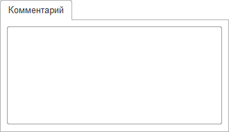
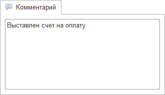
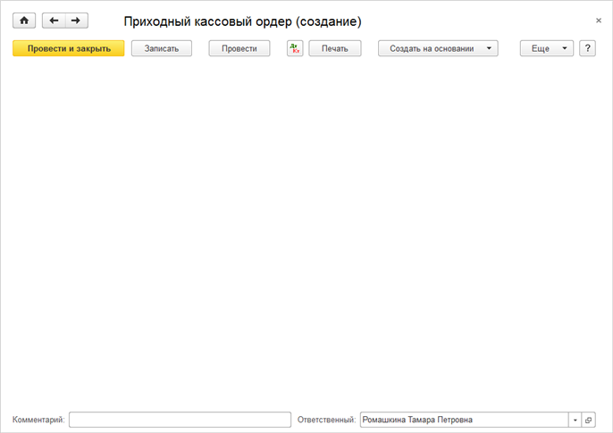

# #std719 Поля "Ответственный" и "Комментарий"

> Область применения: управляемое приложение.
>
> Раздел ИТС: Проектирование интерфейсов для 8.3 / Формы документов
>
> Источник: https://its.1c.ru/db/v8std/content/719/hdoc
>
> Проверено по источнику: 2026-10-07

# 1\. Поле "Комментарий"

Поле "Комментарий" может выводиться:

· В виде однострочного поля в нижней части формы документа

· В виде многострочного поля на отдельной вкладке формы документа

Если поле "Комментарий" в типовых случаях будет большим, то допускается делать его многострочным и выносить на отдельную вкладку. В остальных случаях рекомендуется использовать однострочное поле "Комментарий".

1.1. Однострочное поле "Комментарий"

· Располагается в нижней части формы документа, самым последним

· Заголовок располагается слева от поля

· В поле отсутствует кнопки выбора, списка выбора и другие

1.2. Многострочное поле "Комментарий"

· Располагается на отдельной вкладке

· Заголовок "Комментарий" выводится в названии вкладки. У поля заголовок не отображается

· На вкладке размещается только поле с текстом комментария, которое растягивается по вертикали и по горизонтали

· Если поле с комментарием заполнено, то в заголовке вкладки отражается картинка "Комментарий

# 2\. Поле "Ответственный"

· Поле следует выводить в нижней части формы документа.

# 3\. Группа полей "Ответственный" и "Комментарий"

· При одновременном наличии в форме документа поля "Ответственный" и однострочного поля "Комментарий", их следует объединять в группу.

· Эту группу следует располагать в самом низу формы документа.

· Внутри группы поля размещаются в одну строку, рядом друг с другом.

См. также:

[Реквизит "Комментарий" у документов](<https://its.1c.ru/db/v8std/content/531/hdoc>)

[Поля "Ответственный" и "Комментарий" (8.2)](<https://its.1c.ru/db/v8std/content/587/hdoc>)
