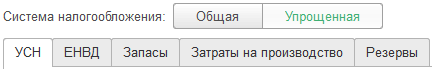
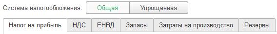

# #std720 Тумблер

> Область применения: управляемое приложение.
>
> Раздел ИТС: Проектирование интерфейсов для 8.3 / Элементы интерфейса
>
> Источник: https://its.1c.ru/db/v8std/content/720/hdoc
>
> Проверено по источнику: 2026-10-07

1\. Тумблер следует использовать в ситуации, когда при выборе значения происходит изменение состава или расположения элементов в форме. Он похож на кнопку и своим видом показывает, что при нажатии может быть изменена видимость элементов, доступность или их содержание.

Например, при выборе системы налогообложения меняется состав вкладок:

2\. Количество кнопок в тумблере рекомендуется делать небольшим, а их названия - краткими. Если количество вариантов - большое, а названия длинные, то лучше использовать выпадающий список.

3\. Заголовок рекомендуется добавлять в случае, если:

\- по названиям кнопок не понятно назначение тумблера

\- тумблер выступает в качестве переключателя
