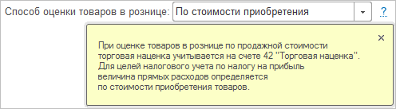
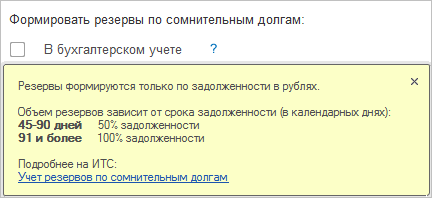
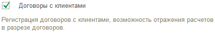
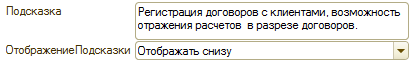
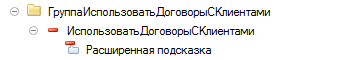
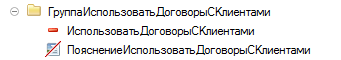

# #std721 Подсказки на форме

> Область применения: управляемое приложение.
>
> Раздел ИТС: Проектирование интерфейсов для 8.3 / Элементы интерфейса
>
> Источник: https://its.1c.ru/db/v8std/content/721/hdoc
>
> Проверено по источнику: 2026-10-07

Подсказки рекомендуется выводить по тем элементам интерфейса, которые требуют пояснения, расшифровки и донесения до пользователя подробного описания их назначения. Для реквизитов, используемых в ежедневной работе, подсказки добавлять не следует.

В тексте подсказки не рекомендуется приводить инструкции и объяснять работу реквизита, вместо этого следует оптимизировать сценарии работы, с ним связанные.

**1\. Текстовые подсказки к полям** 

 

1.1. Текстовые подсказки к полям рекомендуется прятать в гиперссылке "?" Для этого в Конфигураторе устанавливается режим отображения подсказки "Кнопка".  

 

При нажатии на ссылку "?" отображается текст подсказки: 

 

1.2. Если в подсказку, помимо обычного текста, необходимо добавить ссылки, иконки или использовать форматированный текст, то следует использовать "расширенную" подсказку.

Пример расширенной подсказки:

1.3. Не рекомендуется выводить в подсказке много текста (более 255 символов, включая пробелы). Если потребуется более длинная подсказка, то в ней можно дать ссылку на статью ИТС с подробным описанием.

**2\. Текстовые подсказки к настройкам** 

 

2.1. Текстовые подсказки к настройкам следует выводить внизу — под настройкой.

Пример подсказки:

2.2. В конфигураторе подсказки следует оформлять с помощью настройки "Подсказка" с параметром отображения "Отображать снизу".

Пример оформления подсказки:

Допускается так же использование расширенных подсказок. Использование в качестве текстовых подсказок декорации "Надпись" не рекомендуется.

Пример:

<table><tbody><tr><td style="background-color: transparent; vertical-align: top"> 
Правильно
</td><td style="background-color: transparent; vertical-align: top"> 
Неправильно
</td></tr>

<tr><td style="background-color: transparent; vertical-align: top"> 
 
</td><td style="background-color: transparent; vertical-align: top"> 

</td></tr></tbody></table>

Использование декораций "Надпись" для подсказок допустимо в случаях, когда нужное поведение нельзя реализовать иначе. Например, подсказки к полям ввода, которые должны быть выровнены вместе со всем элементом, включая заголовок.

### См. также

- [Подсказка и проверка заполнения](<https://its.1c.ru/db/v8std/content/478/hdoc>)
