# #std722 Компоновка форм

> Область применения: управляемое приложение.
>
> Раздел ИТС: Проектирование интерфейсов для 8.3
>
> Источник: https://its.1c.ru/db/v8std/content/722/hdoc
>
> Проверено по источнику: 2026-10-07

Содержание:

1\. Общие принципы

2\. Вкладки

3\. Вспомогательные формы

4\. Свертываемые группы

# 1\. Общие принципы

1.1. Внутри одной формы все заголовки для однострочных полей ввода, переключателей, тумблеров следует располагать одинаково – или слева, или сверху.

<table><tbody><tr><td style="background-color: transparent; vertical-align: top"> 
Правильно
</td><td style="background-color: transparent; vertical-align: top"> 
Неправильно
</td></tr>

<tr><td style="background-color: transparent; vertical-align: top"> 

 
 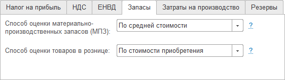
 
 
 
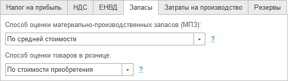
 
 
</td><td style="background-color: transparent; vertical-align: top"> 
 
 
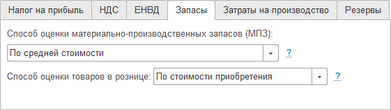
</td></tr></tbody></table>

Заголовки многостраничных полей рекомендуется располагать в зависимости от общей композиции формы.

1.1.1. Если в группе однострочных полей заголовок одного поля существенно длиннее остальных заголовков, рекомендуется сократить название заголовка этого поля или переносить часть такого заголовка на другие строки.

<table><tbody><tr><td style="background-color: transparent; vertical-align: top"> 
Правильно
</td><td style="background-color: transparent; vertical-align: top"> 
Неправильно
</td></tr>

<tr><td style="background-color: transparent; vertical-align: top"> 
 
 
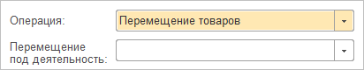
 
 
</td><td style="background-color: transparent; vertical-align: top"> 
 
 
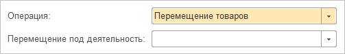
</td></tr></tbody></table>

1.1.2. Поля взаимосвязанных реквизитов, находящиеся в одной группе, должны выравниваться по опорной линии.

<table><tbody><tr><td style="background-color: transparent; vertical-align: top"> 
Правильно
</td><td style="background-color: transparent; vertical-align: top"> 
Неправильно
</td></tr>

<tr><td style="background-color: transparent; vertical-align: top"> 
 
 
 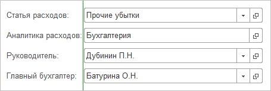
 
 
</td><td style="background-color: transparent; vertical-align: top"> 
 
 
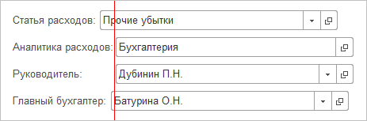
</td></tr></tbody></table>

1.2. Элементы, которые в разных формах выполняют одну и ту же функцию, следует называть одинаково и всегда выводить примерно в одном и том же месте.

Например, реквизит "Контрагент" располагается в левой колонке шапки во всех документах, где выводится.

1.3. Если один из элементов интерфейса влияет на другие элементы, то он должен быть расположен до этих элементов (выше или левее, в зависимости от ситуации). При работе с формой пользователь сначала должен выполнить действия, связанные с основным элементом, а потом уже перейти к работе с зависимыми.

Например, выбор системы налогообложения влияет на состав вкладок, поэтому тумблер для его выбора расположен выше всех вкладок, а не на одной из них:

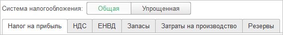

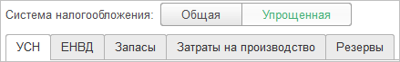

Например, поле "Договор" заполняется после того, как выбран "Контрагент", поэтому расположено в колонке справа от него. Пользователь сначала укажет контрагента в левой колонке, а потом – договор в правой:

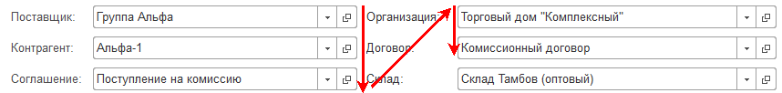

Аналогично, если внутри формы есть взаимосвязанные табличные части, то они должны располагаться рядом друг с другом.

Например, в документе "Отчет комиссионера (агента) о продажах" состав товаров и услуг зависит от выбранного покупателя. Поэтому эти табличные части расположены рядом:

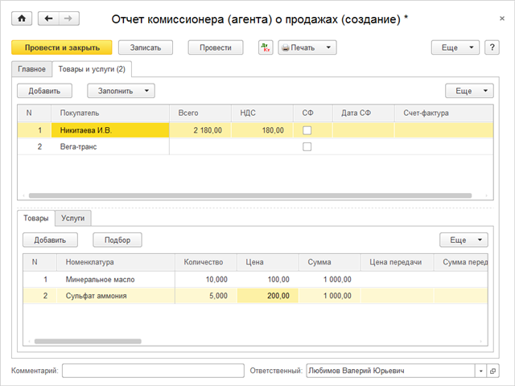

<table style="text-align: left"><tbody><tr style="text-align: left"><td style="background-color: #ffe2e2; text-align: right"> 
<em>Обязательно к соблюдению</em>
 
<em></em>
 
1.3.1. Использование вертикальной зеленой черты для выделенных отдельных элементов и групп взаимосвязанных реквизитов не допускается. В качестве выделения следует использовать состояния: - слабое выделение; - обычное выделение; - нет.
</td></tr></tbody></table>

<table><tbody><tr><td style="background-color: transparent; vertical-align: top"> 
Правильно
</td><td style="background-color: transparent; vertical-align: top"> 
Неправильно
</td></tr>

<tr><td style="background-color: transparent; vertical-align: top"> 
 
 
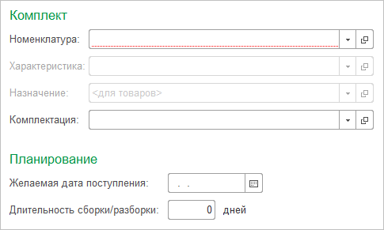
 
 
</td><td style="background-color: transparent; vertical-align: top"> 
 
 
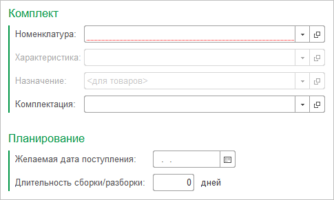
</td></tr></tbody></table>

<table><tbody><tr><td style="background-color: transparent; vertical-align: top"> 
Правильно
</td><td style="background-color: transparent; vertical-align: top"> 
Неправильно
</td></tr>

<tr><td style="background-color: transparent; vertical-align: top"> 
 
 
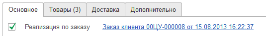
 
 
</td><td style="background-color: transparent; vertical-align: top"> 
 
 
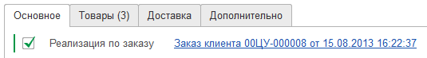
</td></tr></tbody></table>

Использование сильного выделения с вертикальной зеленой полосой допускается в тех случаях, когда группы взаимосвязанных реквизитов располагаются в несколько колонок по горизонтали.

Например, в документе "Шаблон магнитных карт" соблюдается четкое визуальное разделение групп реквизитов:

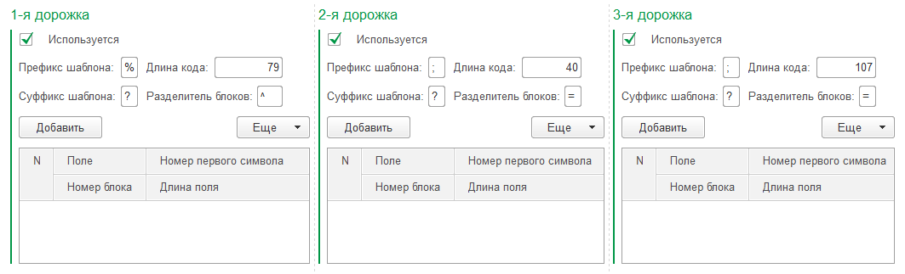

1.4. Внутри формы документа рекомендуется группировать элементы следующим образом:

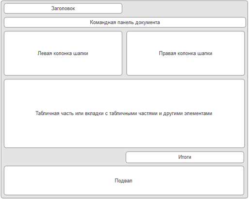

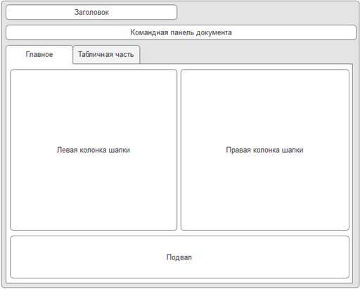

В левой и правой колонках шапки следует располагать реквизиты, необходимые для правильного отражения документа в программе, при этом следует распределять реквизиты по следующим признакам:

<table><tbody><tr><td style="background-color: transparent; vertical-align: top"> 
Левая колонка
</td><td style="background-color: transparent; vertical-align: top"> 
Правая колонка
</td></tr>

<tr><td style="background-color: transparent; vertical-align: top"> 
- важные
 
- заполняются пользователем вручную
 
- обязательны для заполнения
 
- заполняются на основе входящих данных, полученных извне
 
 
 
Например:
 
- Номер и дата
 
- Контрагент
 
- Договор
</td><td style="background-color: transparent; vertical-align: top"> 
- вспомогательные, малозначительные
 
- чаще всего заполняются автоматически
 
- не обязательны для заполнения
 
- значения реквизитов устанавливаются пользователем самостоятельно, по внутренним данным
 
 
 
Например:
 
- Организация
 
- Подразделение 
</td></tr></tbody></table>

В нижней части формы располагается область с итогами и подвал. В подвале могут располагаться поля "Ответственный" и "Комментарий", ссылка на счет-фактуру и другие.

См. также:

- [Итоги в документах](<https://its.1c.ru/db/v8std/content/718/hdoc>)

- [Поля "Ответственный" и "Комментарий"](<https://its.1c.ru/db/v8std/content/719/hdoc>)

1.4.1. При компоновке документов, содержащих табличную часть, следует ориентироваться на видимое количество строк в табличной части. Табличная часть документа должна содержать не менее 7-ми строк (оптимально — не менее 10-ти строк). Если количество строк в табличной части менее 7-ми — рекомендуется размещать табличную часть на отдельной вкладке. 

Например, в документе "Отчет комитенту" реквизиты шапки размещены во вкладке с основными реквизитами:

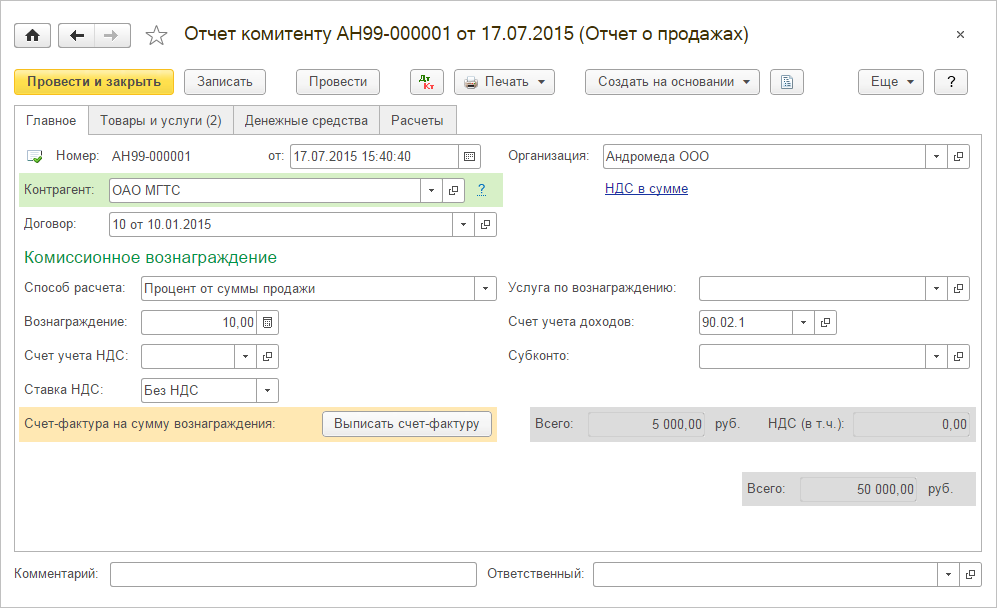

Таким образом, количество строк таблицы вкладки "Товары" реквизитами не ограничивается: 

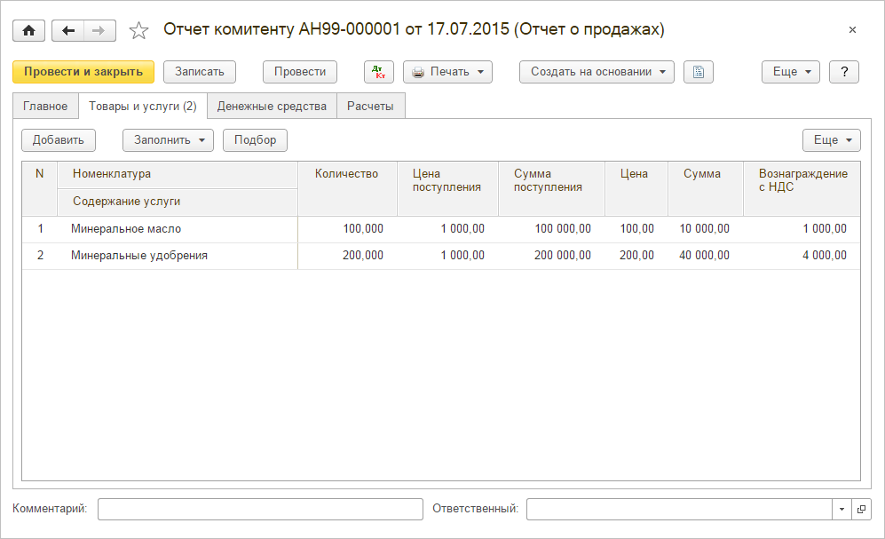

1.4.2. Если на форме имеются несколько невзаимосвязанных табличных частей, то их следует размещать на отдельных вкладках.

1.5. Формы следует проектировать таким образом, чтобы они не были перегружены функциями, реквизитами и элементами. Чтобы этого достичь, можно использовать:

\- возможность скрытия элементов в зависимости от настроек программы или функциональных опций

\- размещение части элементов на отдельных вкладках, в свертываемых группах или во вспомогательных формах

Конкретный способ выбирается в зависимости от ситуации и решаемых задач.

# 2\. Вкладки

2.1. Название вкладки должно отражать суть того, что на ней располагается

Например, по названию вкладки "Товары" понятно, что на ней отображается список товаров:

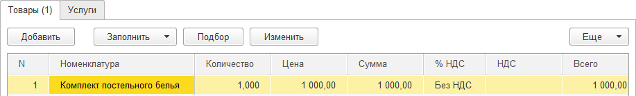

2.2. Поля, обязательные для заполнения, следует располагать на вкладке, активной в момент открытия формы

2.3. Не рекомендуется делать вкладки, содержащие небольшое число элементов (1-2), если они не занимают все пространство вкладки

# 3\. Вспомогательные формы

3.1. При размещении элементов во вспомогательных формах рекомендуется действовать следующим образом:

1\. Среди всего множества реквизитов и элементов выбрать второстепенные, в большинстве случаев заполняемые автоматически, а также те, которые использует небольшое количество пользователей. Чаще всего такие реквизиты будут являться необязательными для заполнения

2\. Разделить эти элементы на несколько смысловых групп

3\. Разместить эти группы в одной или нескольких вспомогательных формах

3.2. Для открытия вспомогательной формы следует использовать гиперссылку, размещаемую в основной форме. При открытии вспомогательная форма блокирует окно владельца.

3.3. Текст гиперссылки может формироваться одним из двух способов.

Вариант 1.  В тексте ссылки указывается название вспомогательной формы. При этом название должно быть таким, чтобы по нему быть понятно, какие реквизиты могут располагаться внутри.

Например:

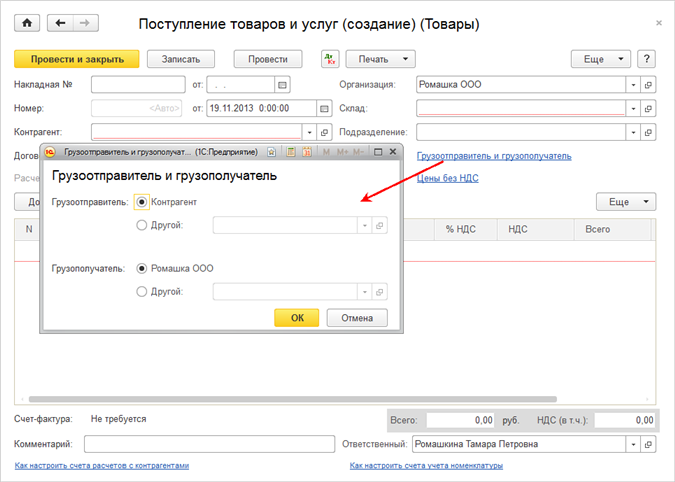

Вариант 2. В тексте ссылки указывается перечень значений реквизитов, заполняемых внутри вспомогательной формы. Если этот перечень слишком велик, то в первую очередь в него следует вынести реквизиты:

\- значения которых важно видеть сразу из основной формы

\- которые обязательны для заполнения

Например:

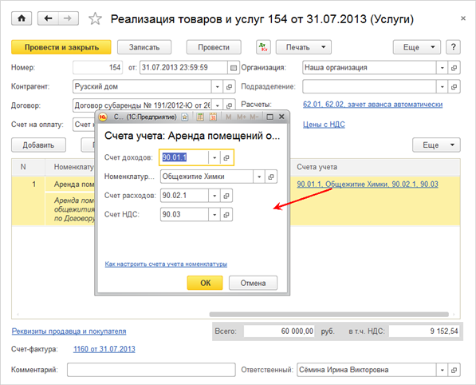

Если текст ссылки выводится в виде перечня значений, то для нее следует добавлять заголовок. В табличной части заголовком будет являться название колонки.

<table><tbody><tr><td style="background-color: transparent; vertical-align: top"> 
Правильно
</td><td style="background-color: transparent; vertical-align: top"> 
Неправильно
</td></tr>

<tr><td style="background-color: transparent; vertical-align: top"> 
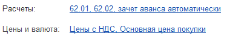
</td><td style="background-color: transparent; vertical-align: top"> 
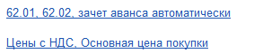
</td></tr></tbody></table>

3.4. Если внутри вспомогательной формы есть реквизиты, обязательные для заполнения, и они не заполнены, то для гиперссылки используется красный цвет (элемент стиля вида цвет "НезаполненныйРеквизит", RGB 178,34,34)Например:

3.5. Командная панель во вспомогательной форме состоит из двух кнопок: "ОК" и "Отмена" и располагается в нижней части формы:

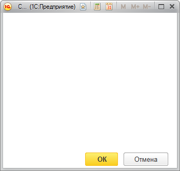

# 4\. Свертываемые группы

4.1. Свертываемые группы являются разделами реквизитов или настроек, логически связанных между собой и объединенных общим заголовком. Возможность свертывания групп позволяет упростить поиск нужного раздела и информации, которая в нем расположена.

4.2. Формы, вся информация в которых размещена в свертываемых группах, рекомендуется отображать с учетом быстрого доступа к содержимому разделов:

\- если все группы в развернутом виде отображаются на странице без вертикальной прокрутки – раскрывать эти группы по умолчанию;

\- если первая группа развернута, а все последующие группы в свернутом виде отображаются на странице без вертикальной прокрутки – раскрывать первую группу по умолчанию.

<table><tbody><tr><td style="background-color: transparent; vertical-align: top"> 
Правильно
</td><td style="background-color: transparent; vertical-align: top"> 
Неправильно
</td></tr>

<tr><td style="background-color: transparent; vertical-align: top"> 
 
 
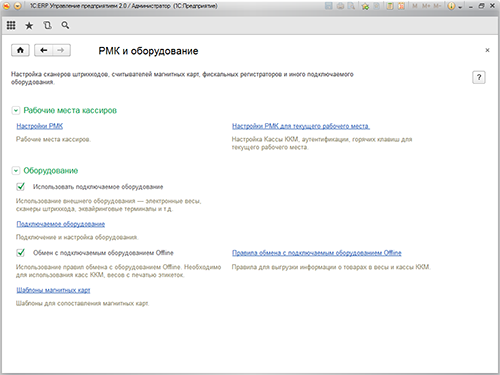
 
 
</td><td style="background-color: transparent; vertical-align: top"> 
 
 
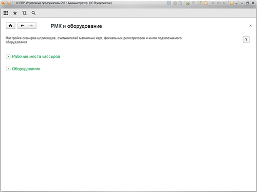
</td></tr></tbody></table>

<table><tbody><tr><td style="background-color: transparent; vertical-align: top"> 
Правильно
</td><td style="background-color: transparent; vertical-align: top"> 
Неправильно
</td></tr>

<tr><td style="background-color: transparent; vertical-align: top"> 
 
 
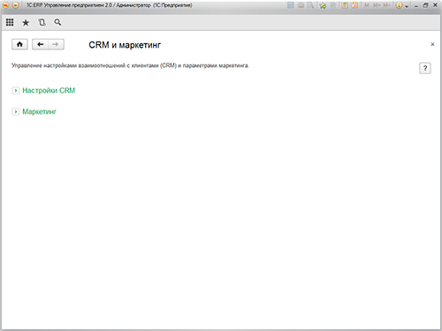
 
 
</td><td style="background-color: transparent; vertical-align: top"> 
 
 
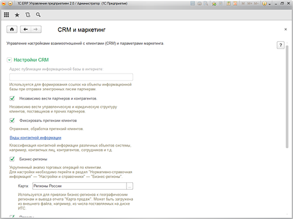
</td></tr></tbody></table>

См. также:

[Компоновка форм (8.2)](<https://its.1c.ru/db/v8std/content/597/hdoc>)

[Оформление элементов (8.2)](<https://its.1c.ru/db/v8std/content/624/hdoc>)

[Переход к форме с дополнительными реквизитами (8.2)](<https://its.1c.ru/db/v8std/content/602/hdoc>)
