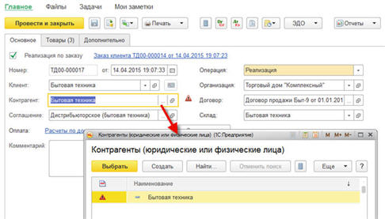
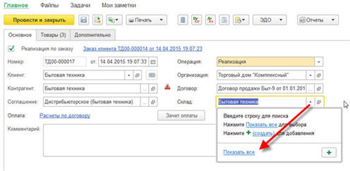

# #std744 История выбора при вводе

> Область применения: управляемое приложение.
>
> Раздел ИТС: Разработка пользовательских интерфейсов / Реализация работы формы
>
> Источник: https://its.1c.ru/db/v8std/content/744/hdoc
>
> Проверено по источнику: 2026-10-07

1\. Для свойства **История выбора** большинства объектов метаданных должно быть установлено значение **Авто**.

2.1. Историю выбора в свойствах объекта метаданных рекомендуется отключать, если ее использование не соответствует прикладной логике конфигурации:

> • для объектов, сценарий использования которых не предполагает повторный выбор из 5 ранее выбранных вариантов.
>
>
>
> Примеры:
>
>
>
> > Специфика использования большинства документов такова, что повторный их выбор маловероятен, например, выбор объекта расчетов в **Поступлении безналичных денежных средств**.
>
>
>
> • для объектов, в модуле менеджера которых переопределена обработка получения данных выбора (есть обработчик **ОбработкаПолученияДанныхВыбора**), т.к. прописанные там условия не учитываются механизмом составления списка истории выбора. Поэтому, используя историю выбора в этом случае, пользователь может получить возможность выбрать значение, которое он не мог бы выбрать другими способами.

2.2. После отключения истории выбора в свойствах объекта метаданных необходимо, во всех ссылающихся на него полях ввода, установить для следующих свойств указанные ниже значения:

> • **КнопкаВыпадающегоСписка** – **Нет** 
>
> • **КнопкаВыбора** – **Да** 
>
> • **ОтображениеКнопкиВыбора** – **В поле ввода**

Это необходимо сделать, чтобы пользователю перед началом выбора в поле ввода не отображалось меню, в котором нужно всегда нажимать «Показать все». 

 

Например:

<table><tbody><tr><td>Правильно</td><td>Неправильно</td></tr>

<tr><td></td><td></td></tr></tbody></table>

Исключения:

Можно не изменять значения свойств полей ввода если:

> > • для поля ввода установлен режим выбора из списка и заполнен (или в метаданных или программно) список выбора 
> >
> > • поле ввода ссылается на объект метаданных с установленным свойством **Быстрый выбор**

Для автоматического изменения свойств полей выбора можно воспользоваться приложенной [обработкой](<https://its.1c.ru/db/files/1CITS/EXE/V8Std/АвтоматическоеИзмененияСвойствПолей/АвтоматическоеИзмененияСвойствПолей.zip>).
