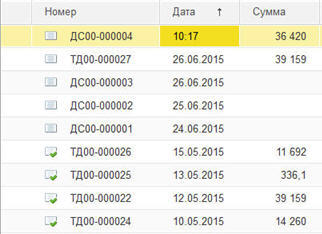
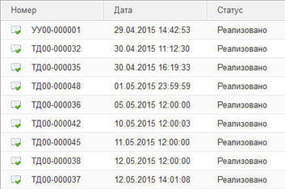

# #std745 Поле "Дата" в списках

> Область применения: управляемое приложение, мобильное приложение.
>
> Раздел ИТС: Разработка пользовательских интерфейсов / Реализация форм списков
>
> Источник: https://its.1c.ru/db/v8std/content/745/hdoc
>
> Проверено по источнику: 2026-10-07

Сокращенное представление поля **Дата** в списках, содержащих реквизит с составом даты **Дата и время**.

В целях оптимизации места на форме, рекомендуется изменить представление поля **Дата** в списках:

> 1\. Установить ширину поля **Дата** без времени: **9 пунктов**<br>
>
> 2\. Отображать дату документов в виде даты без времени: **01.01.2015**<br>
>
> 3\. Для систем оперативного учета, рекомендуется дату сегодняшних документов отображать в виде времени: **09:46**
>
>
>
> <span style="color: #006699">Например:</span>
>
>
>
>
>
>
>
> <table><tbody><tr><td><span style="color: #008000">Рекомендуется</span></td><td><span style="color: #cc0000">Не рекомендуется</span></td></tr>
>
> <tr><td> </td><td></td></tr></tbody></table>

<span style="color: #006699">Пример кода:</span>

```bsl
&НаСервере
Процедура ПриСозданииНаСервере(Отказ, СтандартнаяОбработка)
 СтандартныеПодсистемыСервер.УстановитьУсловноеОформлениеПоляДата(ЭтотОбъект, "Список.Дата", Элементы.Дата.Имя);
КонецПроцедуры
```

Для автоматического изменения свойств полей выбора можно воспользоваться приложенной [обработкой](<https://its.1c.ru/db/files/1CITS/EXE/V8Std/ИзменитьПредставлениеПоляДатаВСписках/ИзменитьПредставлениеПоляДатаВСписках.zip>).

### См. также

- [Даты: требования по локализации](<https://its.1c.ru/db/v8std/content/763/hdoc>)
