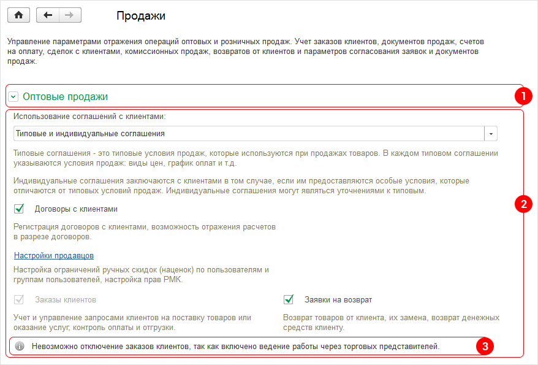
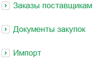
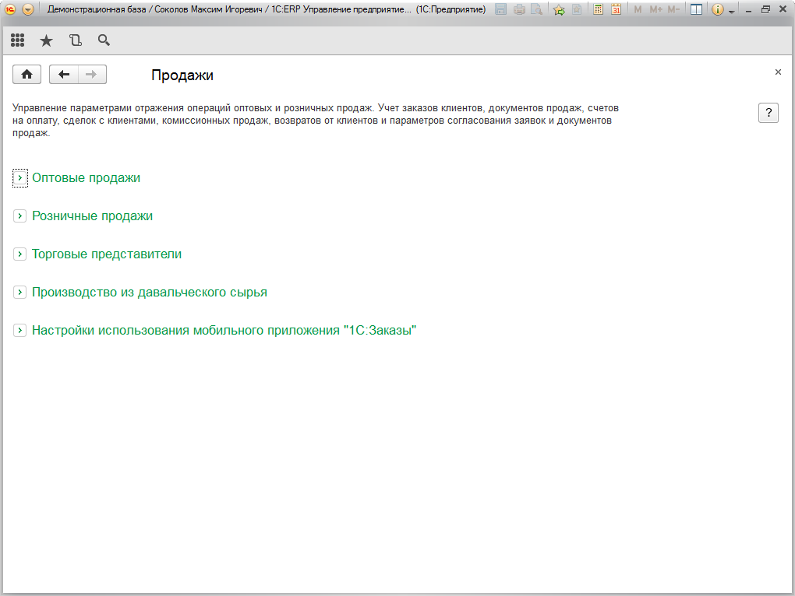
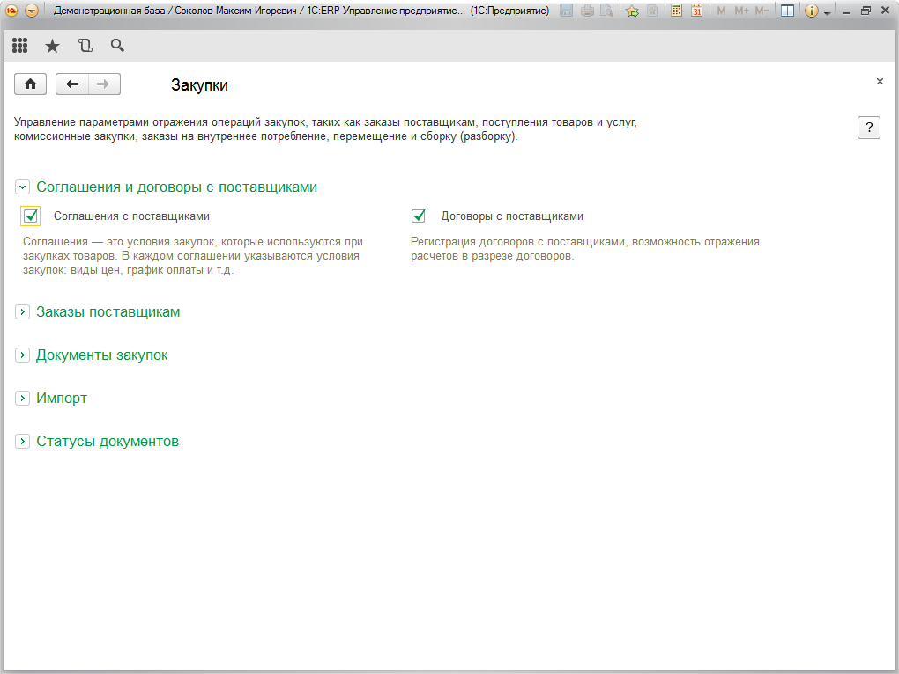
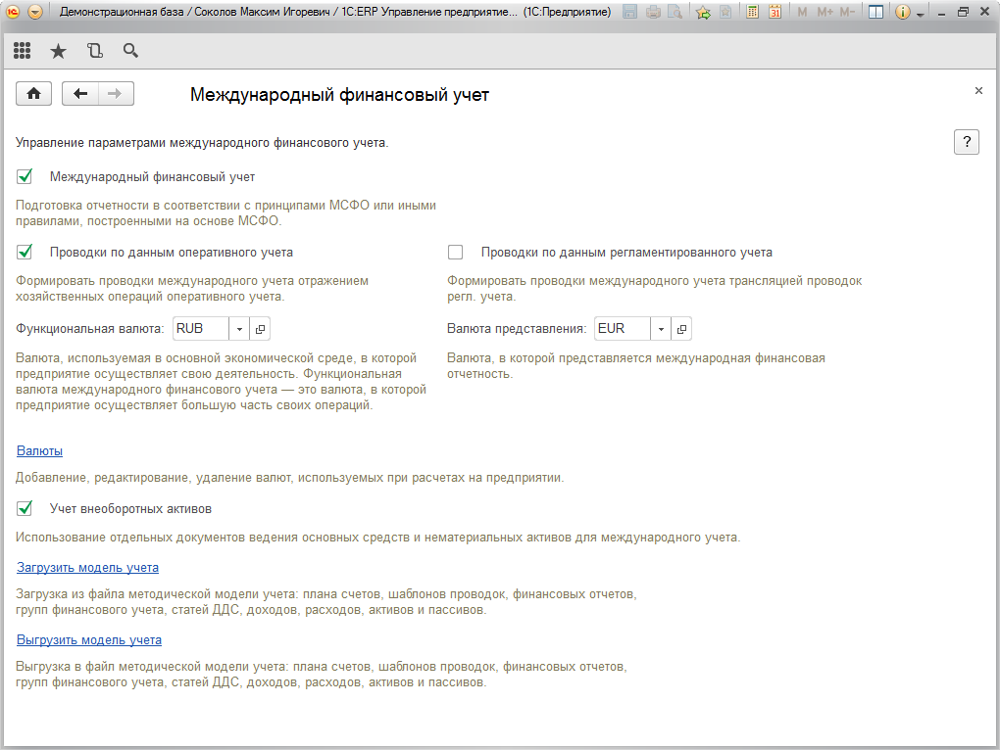

# #std753 Оформление групп разделов с настройками и справочниками

> Область применения: управляемое приложение.
>
> Раздел ИТС: Проектирование интерфейсов для 8.3
>
> Источник: https://its.1c.ru/db/v8std/content/753/hdoc
>
> Проверено по источнику: 2026-10-07

1\. Группа раздела может включать в себя: 

 – Заголовок (1) 

 – Реквизиты и настройки (2) 

 – Информационные сообщения (3).

1.1. Типовым разрешением экрана считается 1280x768 px. Все размеры в стандартах приведены с учетом этих значений.

Например:

2\. Разделы, состоящие из нескольких групп, должны быть реализованы в виде свертываемых групп. Для правильного отображения заголовка свертываемой группы в Конфигураторе используются следующие параметры: 

 – Поведение: Свертываемая

– ОтображениеУправления: Картинка 

 – Отображение: Обычное выделение 

 – ЦветТекстаЗаголовка: Авто

 – ШрифтЗаголовка: Авто.

Например:

2.1. Рекомендуется формировать группы раздела таким образом, чтобы при типовом разрешении 1280х768 пикселей все группы умещались на экране. Следует сворачивать группы, по возможности избегая появления вертикальной прокрутки.

Например, в разделе "Продажи" все группы свернуты по-умолчанию:

2.2. Допускается оставлять первую группу раздела развернутой, если это не повлечет за собой "растягивания" формы за пределы типового разрешения экрана 1280х768 пикселей.

Например, в разделе "Закупки" первая группа развернута — остальные группы в свернутом виде не выходят за рамки экрана:

3\. Раздел, состоящий из одной группы, должен быть развернутым и иметь параметры "Поведение: Обычное". Заголовок в такой группе не используется.

Например:

