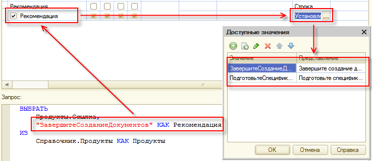
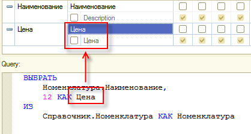
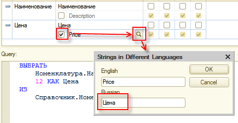
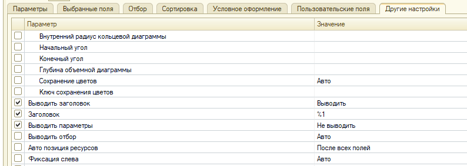
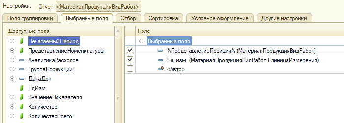
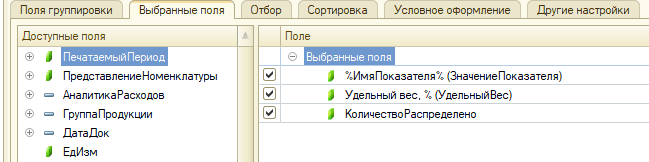
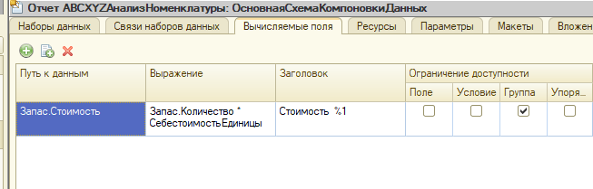
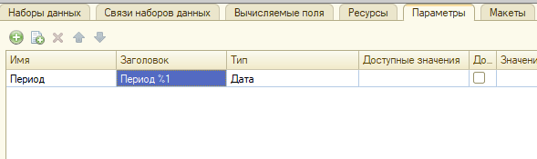

# #std762 Запросы, динамические списки и отчеты на СКД: требования по локализации

> Область применения: управляемое приложение, мобильное приложение, обычное приложение.
>
> Раздел ИТС: Требования по локализации
>
> Источник: https://its.1c.ru/db/v8std/content/762/hdoc
>
> Проверено по источнику: 2026-10-07

<a id="1"></a>1\. В некоторых случаях строковые литералы из текстов запросов также могут оказаться частью пользовательского интерфейса. В таких случаях строковые литералы необходимо выносить из текста запроса в параметры.

Неправильно:

```bsl
ЗапросПоВерсиям = Новый Запрос("
  |ВЫБРАТЬ
  |Версии.Ссылка,
  |ВЫБОР КОГДА Версии.Выпущена = ИСТИНА
  | ТОГДА ""выпущена""
  | ИНАЧЕ ""в разработке""
  |КОНЕЦ КАК ТекстПояснения
  | ИЗ
  | Справочник.Версии КАК Версии");
```

Также неправильно:

```bsl
ТекстЗапроса =
  "ВЫБРАТЬ
  |Версии.Ссылка,
  |ВЫБОР КОГДА Версии.Выпущена = ИСТИНА
  | ТОГДА &ТекстВыпущеннойВерсии
  | ИНАЧЕ &ТекстНеВыпущеннойВерсии
  |КОНЕЦ КАК ТекстПояснения
  | ИЗ
  | Справочник.Версии КАК Версии");

  ТекстЗапроса = СтрЗаменить(ТекстЗапроса, "&ТекстВыпущеннойВерсии", НСтр("ru='выпущена'"));
  ТекстЗапроса = СтрЗаменить(ТекстЗапроса, "&ТекстНеВыпущеннойВерсии", НСтр("ru='в разработке'"));
```

Правильно:

```bsl
ЗапросПоВерсиям = Новый Запрос("
  |ВЫБРАТЬ
  |Версии.Ссылка,
  |ВЫБОР КОГДА Версии.Выпущена = ИСТИНА
  | ТОГДА &ТекстВыпущеннойВерсии
  | ИНАЧЕ &ТекстНеВыпущеннойВерсии
  |КОНЕЦ КАК ТекстПояснения
  | ИЗ
  | Справочник.Версии КАК Версии");

ЗапросПоВерсиям.УстановитьПараметр("ТекстВыпущеннойВерсии", НСтр("ru='выпущена'"));
ЗапросПоВерсиям.УстановитьПараметр("ТекстНеВыпущеннойВерсии", НСтр("ru='в разработке'"));
```

<a id="2"></a>2\. Аналогичные требования предъявляются к выражениям СКД и запросам, которые используются в наборах данных СКД и содержат строковые литералы, выводимые в пользовательском интерфейсе. Например, если в выражении для параметров СКД встречаются строковые константы, требующие перевода, то следует:

а) в запросе указывать строковые константы, соответствующие "Правилам образования имен переменных" (""ЗавершитеСозданиеДокументов" КАК Рекомендация "), а в списке доступных значений поля указать локализуемый строковый литерал ("Завершите создание документов");



б) либо значение таких параметров с помощью функции **НСтр** устанавливать не в колонке Выражение, а в модуле отчета в обработчике события **ПриКомпоновкеРезультата**

Неправильно:

```bsl
ВЫБОР
  КОГДА ВидОперации = "Отгрузка клиентам" ТОГДА 1
  КОГДА ВидОперации = "Возвраты товаров от клиентов" ТОГДА 2
  КОГДА ВидОперации = "Приемка от поставщиков" ТОГДА 3
КОНЕЦ
```

Правильно:

```bsl
ВЫБОР
  КОГДА ВидОперации = &ВидОперацииОтгрузкаКлиентам ТОГДА 1
  КОГДА ВидОперации = &ВидОперацииВозвратыТоваровОтКлиентов ТОГДА 2
  КОГДА ВидОперации = &ВидОперацииПриемкаОтПоставщиков ТОГДА 3
КОНЕЦ
```

в) В выражениях, используемых в настройках СКД, например **Выражение представления** и **Выражение упорядочивания** на закладке **Наборы данных**, а также в других им подобных, необходимо использовать функцию **НСтр**, аналогично тому, как это делается в коде модулей (см. стандарт [Интерфейсные тексты в коде: требования по локализации](<https://its.1c.ru/db/v8std/content/761/hdoc>)).

Неправильно:

```bsl
Выбор Когда Объект = Раздел
  Тогда Выбор
    Когда Раздел = Значение(ПланВидовХарактеристик.РазделыДатЗапретаИзменения.ПустаяСсылка)
      Тогда "<Для всех разделов и объектов, кроме указанных>"
    Иначе "<Для всех объектов, кроме указанных>"
  Конец
  Иначе Объект
Конец
```

Правильно:

```bsl
Выбор Когда Объект = Раздел
  Тогда Выбор
    Когда Раздел = Значение(ПланВидовХарактеристик.РазделыДатЗапретаИзменения.ПустаяСсылка)
      Тогда НСтр("ru='<Для всех разделов и объектов, кроме указанных>'")
    Иначе НСтр("ru='<Для всех объектов, кроме указанных>'")
  Конец
  Иначе Объект
Конец
```

<a id="3"></a>3\. Для колонок отчета на СКД для поля выборки, полученного вычислением с заданием ему псевдонима, необходимо задавать синоним при разработке. Нельзя опираться на автоматически сгенерированный заголовок по имени/псевдониму.

Неправильно:



Правильно:



В отчётах, если не стоит галочка у поля выборки, полученного вычислением с заданием ему псевдонима, оно не попадает в результаты поиска редактирования текстов интерфейсов.

<a id="4"></a>4\. Для заголовков отчетов СКД, полей, вычисляемых полей и параметров допустимо использовать параметры подстановки через функцию **СтрШаблон**: %1, %2 и т.д.; а также два варианта именованных параметров подстановки: **\[Параметр\]**, **%Параметр%**. Имя параметра должно удовлетворять [правилам образования имен переменных.](<https://its.1c.ru/db/v8std/content/454/hdoc>)

Такие параметры затем можно заменить в обработчике модуля отчета **ПриКомпоновкеРезультата** в тех случаях, когда заголовки отчета или его полей зависят от прикладной логики и вычисляются в коде.





<br>



<br>



<br>



### См. также

- [Оформление текстов запросов](<https://its.1c.ru/db/v8std/content/437/hdoc>)
