# #std765 Элементы форм: требования по локализации

> Область применения: управляемое приложение, мобильное приложение, обычное приложение.
>
> Раздел ИТС: Требования по локализации
>
> Источник: https://its.1c.ru/db/v8std/content/765/hdoc
>
> Проверено по источнику: 2026-10-07

<a id="1"></a>1\. Нельзя присваивать реквизитам, используемым в элементах формы, строковые значения, не прошедшие локализацию. Рекомендуется для этого использовать, списки значений, в которых для каждого значения задается локализуемое представление, или перечисления, если они используются в таблицах базы данных.

Неправильно:

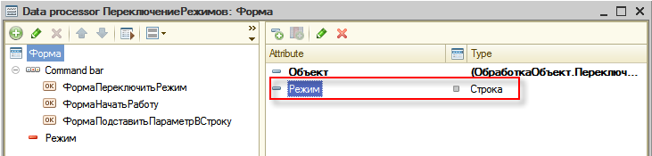

```bsl
Если Режим = "Рабочий" Тогда
	Режим = "Демо";
Иначе
	Режим = "Рабочий";
КонецЕсли;
```

Правильно:

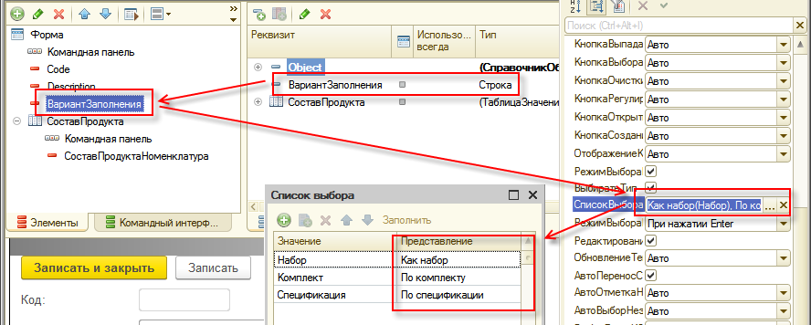

Правильно:

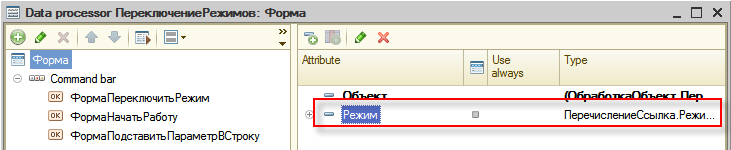

```bsl
Если Режим = Перечисления.РежимыРаботы.Рабочий Тогда
	Режим = Перечисления.РежимыРаботы.Демо;
Иначе
	Режим = Перечисления.РежимыРаботы.Рабочий;
КонецЕсли;
```

*Методическая рекомендация (полезный совет)*

<a id="2"></a>2\. Для всех таблиц и групп на формах необходимо указывать заголовки, и, если эти заголовки не нужно показывать пользователю, в свойствах элемента формы в явном виде убирать отображение заголовка элемента.

Это требование связано с тем, что, если заголовок не указан, при использовании команды **Изменить форму** пользователь увидит заголовки, автоматически сгенерированные из имен элементов формы, а перевести их будет невозможно, потому что такие заголовки попадут в выгрузку на перевод как пустые, и переведены не будут.

Неправильно:

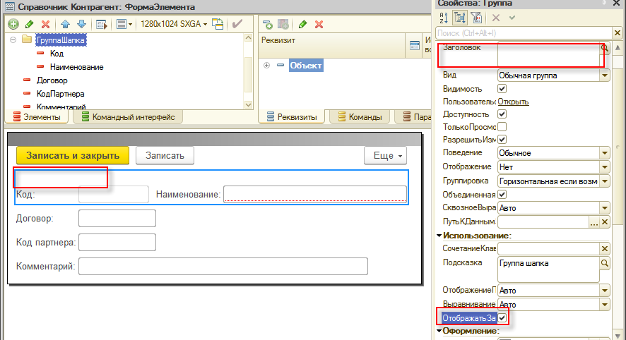

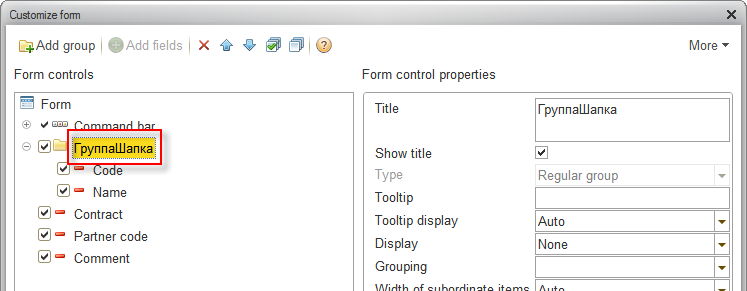

Правильно:

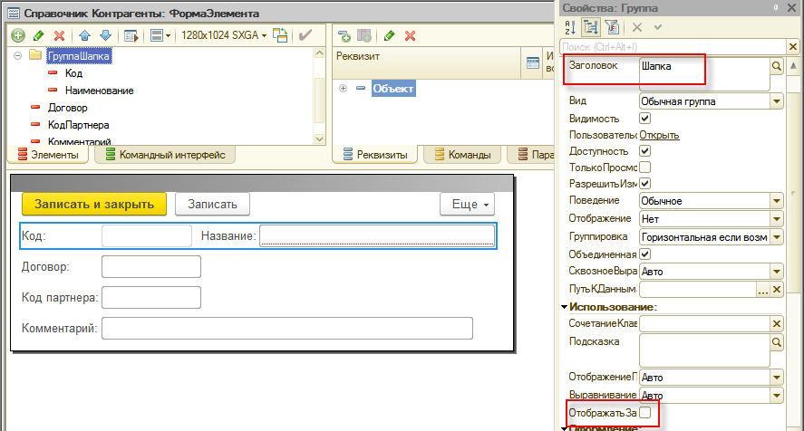

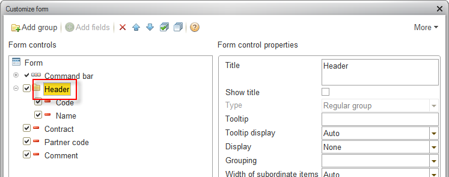

Для автоматической расстановки заголовков можно воспользоваться обработкой [автоформатирования кода и локализации](<https://its.1c.ru/db/files/1CITS/EXE/V8Std/АвтоформатированиеКодаИЛокализация/АвтоформатированиеКодаИЛокализация.zip>).

<a id="3"></a>3\. Следует уменьшать количество незначащей информации, подлежащей локализации.

<a id="3.1"></a>3.1. Удалять бессмысленные подсказки у групп форм. См. стандарт [Подсказка и проверка заполнения](<https://its.1c.ru/db/v8std/content/478/hdoc>).

Это связано не только со стремлением удешевить перевод, но и с тем, что пользователь может увидеть такие подсказки, например, когда будет изменять форму.

Неправильно:

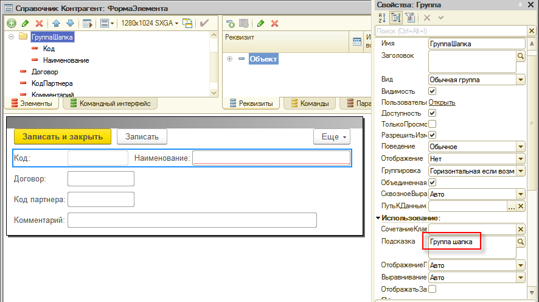

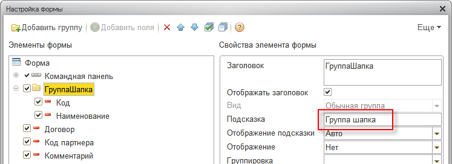

Правильно:

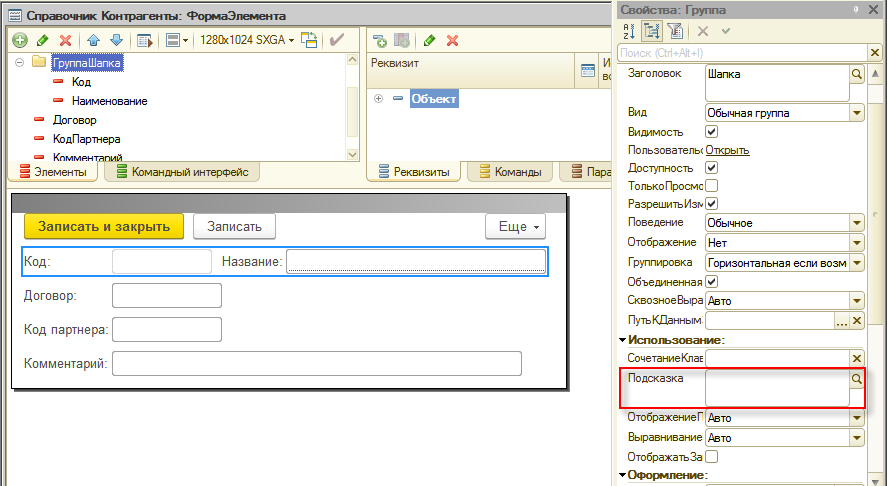

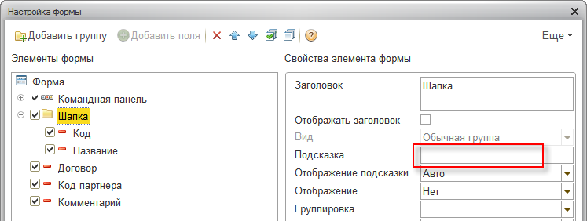

<a id="3.2"></a>3.2. У реквизитов формы, не размещенных на форме в виде элементов управления, следует очищать заголовки, т.к. они не видны пользователю. Как правило, это служебные реквизиты, используемые для технологических целей.

Для удаление бессмысленных подсказок можно воспользоваться обработкой, приложенной к статье [Тексты модулей](<https://its.1c.ru/db/v8std/content/456/hdoc>).

<a id="4"></a>4\. Следует задавать заголовок для колонок динамического списка, получающихся в запросе комбинацией других колонок или для которых задан свой псевдоним. Нельзя опираться на автоматически сгенерированный заголовок по имени/псевдониму.

Например, неправильно:

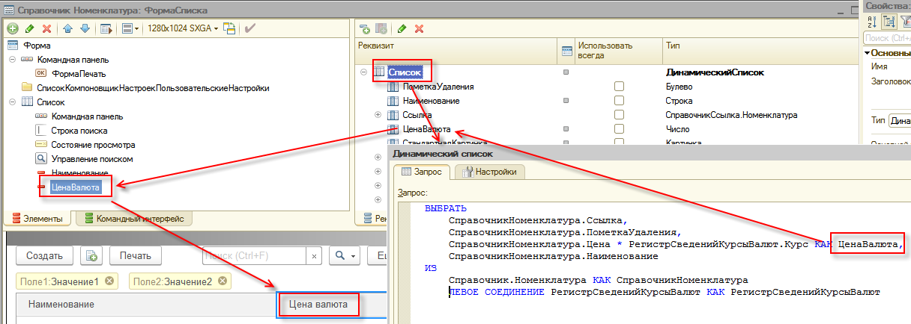

Правильно:

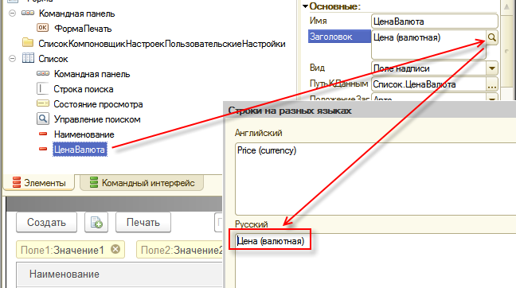

Примеры, когда заголовок колонок следует задавать в явном виде:

```bsl
ВЫБРАТЬ
    Таблица.Поле1 КАК Поле2
    ВЫРАЗИТЬ(Таблица.Поле1 КАК СТРОКА(100)) КАК Поле3
```

В таком случае, когда поле создается в запросе и ему присваивается имя, то синоним не "подтягивается" автоматически из метаданных, т.к. не существует реквизита, связанного с этим полем. Инструментом редактирования текстов интерфейсов не находится заголовок для колонок в динамическом списке, которым задан псевдоним в запросе. Имя колонки динамического списка должно быть задано, даже если заголовок поля не выводится на форму, так как имена колонок выводятся пользователю при настройке полей формы (команда **Еще** \- **Изменить форму...**).

<a id="5"></a>5\. В полях форм со списками выбора следует всегда устанавливать свойство **РежимВыбораИзСписка** в значение **Истина**. В этом случае, в поле будет корректно выводиться локализуемое представление, а не значение из списка выбора.

### См. также

- [Группы элементов формы](<https://its.1c.ru/db/v8std/content/621/hdoc>)
