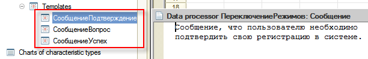
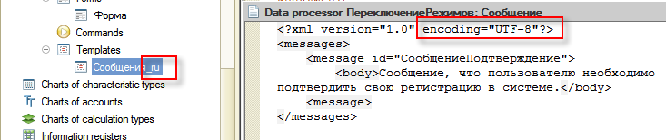

# #std766 Макеты: требования по локализации и поддержке разных языков интерфейса

> Область применения: управляемое приложение, мобильное приложение, обычное приложение.
>
> Раздел ИТС: Требования по локализации
>
> Источник: https://its.1c.ru/db/v8std/content/766/hdoc
>
> Проверено по источнику: 2026-10-07

<a id="1"></a>1\. Как правило, перевод табличных, текстовых и HTML-макетов на другие языки не требует каких-либо подготовительных действий при разработке конфигурации. Особым случаем являются двоичные макеты, подлежащие переводу, а также HTML-макеты, содержащие изображения, которые должны быть отдельно подготовлены на разных языках. Например, это двоичные макеты печатных форм в форматах офисных документов, HTML-макеты с инструкциями, включающие скриншоты интерфейса программы или изображения, содержащие текстовую информацию.

Такой макет необходимо пометить специальным образом, пометка будет означать, что при переводе будет необходимо создавать копию, а не переводить содержимое макета. Для этого в имени макета следует указывать постфикс в виде подчеркивания и кода языка так, как он задан в метаданных, в языке **Русский** в свойстве **Код языка**: **"\_ru"**. <br>

Например, неправильно:

макет **ПФ\_ODT\_СчетНаОплату** (макет печатной формы счета на оплату в формате OpenOffice Writer)

правильно указывать в имени постфикс основного языка:

макет **ПФ\_ODT\_СчетНаОплату\_ru**

При добавлении языков интерфейса следует добавлять макеты с соответствующими постфиксами. В коде, в зависимости от языка, использовать макет с соответствующим постфиксом. Например, неправильно:

```bsl
... = ПолучитьОбщийМакет("ПФ_ODT_СчетНаОплату");
```

правильно:

```bsl
... = ПолучитьОбщийМакет("ПФ_ODT_СчетНаОплату" +  "_" + ТекущийЯзык());
```

Кроме того, для исключения ошибок при частичном переводе конфигурации, рекомендуется выполнять получение макета в три этапа:

- Сначала по **ИмяМакета** \+ "\_" + ТекущийЯзык();

- Если не найден, то по **ИмяМакета** \+ "\_" + **Метаданные.ОсновнойЯзык.КодЯзыка**;

- Если не найден, то по переданному имени **ИмяМакета**.

- И наконец установить свойство **КодЯзыка** (у табличного документа) или **КодЯзыкаМакета** (у текстового документа и HTML-макета), как указано далее в п.2.

<a id="2"></a>2\. При разработке конфигураций, рассчитанных на несколько языков интерфейса, может возникнуть задача в одном сеансе пользователя формировать печатные формы на разных языках, а не только на текущем языке интерфейса. Например, в сеансе англоязычного пользователя сформировать счет на оплату на русском языке.

Для получения данных из табличного, текстового или HTML-макета на заданном языке, отличном от языка интерфейса текущего пользователя, необходимо использовать свойство **КодЯзыка** (доступно у табличного документа) и **КодЯзыкаМакета** (у текстового документа и HTML-макета).

Правильно:

```bsl
Макет = ПолучитьОбщийМакет("ПечатнаяФорма");
Макет.КодЯзыкаМакета = "ru";
HTMLДокумент = Макет.ПолучитьДокументHTML();
```

<a id="3"></a>3\. При разработке конфигураций, рассчитанных на несколько языков интерфейса, может также возникнуть задача формировать печатные формы строго на одном языке, не зависимо от текущего языка интерфейса. Примером таких макетов могут служить регламентированные формы отчетности для государственных учреждений. Например, пользователи с любым языком интерфейса должны формировать русскоязычную счет-фактуру – налоговый документ строго установленного образца в соответствии с Налоговым кодексом Российской Федерации (не существует российских счет-фактур на других языках, кроме русского).

Для табличных и HTML-макетов, которые должны выводится пользователю и на печать строго на одном языке, следует

- указывать в наименовании постфикс кода языка, аналогично п.1

- и устанавливать код языка макета аналогично п.2 при программном получении макета в коде.

Такие макеты не должны переводиться на другие языки интерфейса. При программном формировании текстов для заполнения макета следует явно указывать второй параметр в функции **НСтр()** для того, чтобы строки были сформированы на том же языке, что и макет.

Например, не правильно:

```bsl
Макет = ПолучитьМакет("ПФ_MXL_СчетФактура");
...
Область.Текст = НСтр("ru='Заголовок печати';");
```

Правильно:

```bsl
Макет = ПолучитьМакет(("ПФ_MXL_СчетФактура_ru");
Макет.КодЯзыка = Метаданные.Языки.Русский.КодЯзыка;
...
Область.Текст = НСтр("ru='Заголовок печати';", Метаданные.Языки.Русский.КодЯзыка);
```

При использовании **Библиотеки стандартных подсистем (БСП)** и подсистемы **Печать** получение макета через функцию **УправлениеПечатью.МакетПечатнойФормы("ПФ\_MXL\_СчетФактура")** позволяет получить форму **ПФ\_MXL\_СчетФактура\_ru** и устанавливает у макета свойство **КодЯзыка**.

<a id="4"></a>4\. Если в текстах макетов используются именованные параметры подстановки, необходимо соблюдать для них [требования по локализации интерфейсных текстов в коде](<https://its.1c.ru/db/v8std/content/761/hdoc>).

<a id="5"></a>5\. Кодировку в макетах использовать UTF-8.

<a id="6"></a>6\. Также, по возможности, следует группировать однотипные макеты (использовать один макет вместо нескольких). Например, в следующем примере в конфигурации имеется несколько однотипных макетов с сообщениями, но их содержимое записывается в один справочник, поэтому правильно хранить все подобные сообщения в одном макете.

Неправильно:



```bsl
Макет = Обработки.ПереключениеРежимов.ПолучитьМакет("Сообщение");
```

Правильно:



```bsl
Макет = Обработки.ПереключениеРежимов.ПолучитьМакет(СтроковыеФункцииКлиентСервер.ПодставитьПараметрыВСтроку("Сообщения_%1", ОбщегоНазначения.КодОсновногоЯзыка()));
```

<a id="7"></a>7\. Внешние компоненты следует размешать в макетах с типом макета **внешняя компонента**. При разработке внешней компоненты требуется обрабатывать метод **SetLocale** для локализации внешней компоненты в соответствии с полученным кодом локализации (см. [Технология создания внешних компонент](<https://its.1c.ru/db/content/metod8dev/src/developers/platform/i8103221.htm?_=1557748351>)). Если полученный код локализации отличается от предусмотренного во внешней компоненте, то компонента должна настроить свое окружение на использование английского языка.
