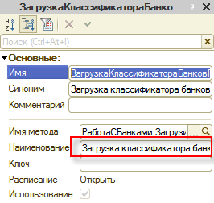
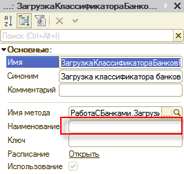

# #std767 Регламентные задания: требования по локализации

> Область применения: управляемое приложение, мобильное приложение, обычное приложение.
>
> Раздел ИТС: Требования по локализации
>
> Источник: https://its.1c.ru/db/v8std/content/767/hdoc
>
> Проверено по источнику: 2026-10-07

<a id="1"></a>1\. Предопределенным регламентным заданиям не следует задавать наименования в конфигураторе. Вместо этого, достаточно задать синоним предопределенного регламентного задания.

Неправильно:



Правильно:



Для непредопределенных (параметризованных) регламентных заданий наименование задается программно, оформляется с НСтр и может описывать контекст выполнения задания.

Правильно:

```bsl
Задание = РегламентныеЗадания.СоздатьРегламентноеЗадание(Метаданные.РегламентныеЗадания.РассылкаОтчетов);
Задание.Наименование = СтроковыеФункцииКлиентСервер.ПодставитьПараметрыВСтроку(НСтр("ru = 'Рассылка отчетов: %1'"), РассылкаОтчетов);
Задание.Записать();
```

Это связано с тем, что в отсутствие наименования платформа возьмет его автоматически из локализуемого синонима. Если же наименование задано, то будет использоваться оно, а оно не поддерживает локализацию.

### См. также

- [Общие требования к регламентным заданиям](<https://its.1c.ru/db/v8std/content/540/hdoc>)
