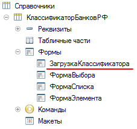
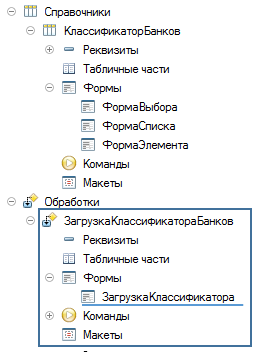
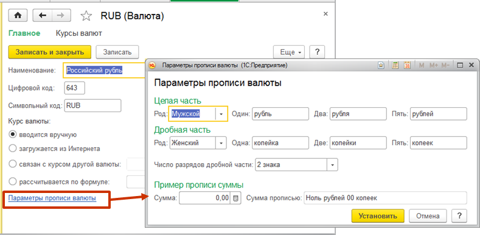

# #std769 Поставка международной версии конфигурации

> Область применения: управляемое приложение, мобильное приложение, обычное приложение.
>
> Раздел ИТС: Требования по локализации
>
> Источник: https://its.1c.ru/db/v8std/content/769/hdoc
>
> Проверено по источнику: 2026-10-07

> *Применим для локализуемых конфигураций (и входящих в них библиотек), на базе которых выпускаются национальные прикладные решения для различных стран или регионов.*

Для упрощения работы локализаторов при первичной локализации конфигурации, а также при последующих обновлениях следует выпускать международную версию конфигурации, подготовленную для создания национальных версий. При этом разработку локализованных версий конфигурации рекомендуется вести на базе международной версии.

Все требования данного раздела (группа стандартов **Требования по локализации**) одинаково применимы к обоим версиям конфигурации. В частности, национальные версии также могут поставляться с интерфейсами на нескольких языках. Например, ERP для России с англоязычным интерфейсом для работы иностранцев в одной информационной базе с русскоговорящими пользователями.

С целью уменьшения трудозатрат на выделение национальной специфики следует анализировать в первую очередь зарубежные версии конфигураций, опубликованные на [портале 1С](<https://releases.1c.ru>).

Для подготовки международной версии конфигурации:

<a id="1"></a>1\. Национальную (российскую) специфику в программном коде и формах конфигурации необходимо выделить в отдельные объекты метаданных, которые должны отсутствовать в международной версии. <br>

Например,

неправильно:



правильно:



<a id="1.1"></a>1.1. Реквизиты объектов, относящиеся к национальной специфике, рекомендуется оставлять в объектах, но при этом обеспечить работоспособность конфигурации в случае их удаления.

<a id="1.2"></a>1.2. В формах объектов, где к национальной специфике относится лишь часть элементов, рекомендуется выносить такие элементы в отдельную форму, <br>

например:



<a id="1.3"></a>1.3. К национальной специфике могут относиться и алгоритмы, например: загрузка курсов валют. Их также следует выделять в отдельных объектах метаданных.

<a id="1.4"></a>1.4. В случае, когда подсистема или отдельный объект в большей части является международным, но при этом очевидна необходимость реализации некоторой национальной специфики, рекомендуется создавать общие модули с постфиксом **Локализация**. В алгоритмах, в которых есть потребность дополнить или переопределить поведение, предусмотреть переход в эти модули. Процедуры должны размещаться в области **ПрограммныйИнтерфейс**. При этом в международной поставке модули с постфиксом **Локализация** не должны содержать прикладного кода.

В национальной конфигурации код внутри процедур следует обрамлять комментариями **Локализация** и **Конец Локализация**. Если международная поставка изготавливается из национальной, то такие фрагменты кода должны удаляться из прикладного кода, включая обрамляющие комментарии. Например, в национальной конфигурации:

```bsl
Процедура ПриОпределенииСимволовНациональногоАлфавита(СимволыНациональногоАлфавита, ДополнительныеДопустимыеСимволы) Экспорт

	// Локализация
	СимволыНациональногоАлфавита = "абвгдеёжзийклмнопрстуфхцчшщъыьэюя";
	// Конец Локализация

КонецПроцедуры
```

В международной поставке:

```bsl
Процедура ПриОпределенииСимволовНациональногоАлфавита(СимволыНациональногоАлфавита, ДополнительныеДопустимыеСимволы) Экспорт

КонецПроцедуры
```

При этом не следует обрамлять комментариями **Локализация** и **Конец Локализация** фрагменты кода, содержащие национальную (российскую) специфику любых других объектов и модулей. В таких случаях разработчик не сможет при необходимости доопределить национальную специфику.

Неправильно:

```bsl
Функция АдресВОблачномСервисе(Сервис, Href) Экспорт

    АдресОбъекта = "";

	Если Сервис = "Box" Тогда
	    АдресОбъекта = "https://app.box.com/files/0/";
	// Локализация
	ИначеЕсли Сервис = "Yandex" Тогда
	    АдресОбъекта = "https://disk.yandex.ru/client/disk/";
	// Конец Локализация
	ИначеЕсли Сервис = "Dropbox" Тогда
	    АдресОбъекта = "https://www.dropbox.com/home/";
	КонецЕсли;

	Возврат АдресОбъекта + Href;

КонецФункции
```

Правильно:

```bsl
Функция АдресВОблачномСервисе(Сервис, Href) Экспорт

	АдресОбъекта = "";

	Если Сервис = "Box" Тогда
	    АдресОбъекта = "https://app.box.com/files/0/";
	ИначеЕсли Сервис = "Dropbox" Тогда
	    АдресОбъекта = "https://www.dropbox.com/home/";
	Иначе
	    РаботаСФайламиЛокализация.ПриОпределенииАдресаОблачногоСервиса(Сервис, АдресОбъекта);
        КонецЕсли;

	Возврат АдресОбъекта + Href;

КонецФункции
```

В общем модуле **РаботаСФайламиЛокализация**:

```bsl
Процедура ПриОпределенииАдресаОблачногоСервиса(Сервис, АдресОбъекта)

	// Локализация
	Если Сервис = "Yandex" Тогда
	    АдресОбъекта = "https://disk.yandex.ru/client/disk/";
	КонецЕсли;
	// Конец Локализация

КонецПроцедуры
```

Например, функциональность закрытия месяца является международной, но при этом есть необходимость дополнять список этапов теми этапами, которые реализуют национальную специфику.

В этом случае добавляется общий модуль **ЗакрытиеМесяцаЛокализация**, а из процедуры **ЗакрытиеМесяца**.**ДобавитьЭтапыЗакрытияМесяца** вызвается соответствующий метод модуля ЗакрытиеМесяцаЛокализация. При этом в международной поставке конфигурации общий модуль **ЗакрытиеМесяцаЛокализация** будет содержать только определение метода **ДобавитьЭтапыЗакрытияМесяца**.

<a id="1.5"></a>1.5. В случае, когда национальная специфика занимает большую часть подсистемы, рекомендуется относить к национальной специфике всю подсистему. Например: подсистема «Склонение представлений объектов» целиком является национальной спецификой.

<a id="1.6"></a>1.6. Перечислить объекты метаданных, содержащих национальную (российскую) специфику, в файле ЛокализуемыеОбъекты&lt;…&gt;.txt, и включить его в дистрибутив типовой конфигурации.

Файл ЛокализуемыеОбъекты&lt;…&gt;.txt содержит имена объектов метаданных в том виде, в котором их возвращает функция ОбъектМетаданных.ПолноеИмя(). Каждое имя объекта начинается с новой строки. Допускаются комментарии в таком же виде, как и в коде конфигурации.

Пример:

```bsl
// Банки
Обработка.ЗагрузкаКлассификатораБанков
РегламентноеЗадание.ЗагрузкаКлассификатораБанков
Справочник.КлассификаторБанков.Реквизит.ИНН

// Валюты
Обработка.ЗагрузкаКурсовВалют
РегламентноеЗадание.ЗагрузкаКурсовВалют
```

<a id="2"></a>2\. Удобство пользовательского интерфейса не должно страдать при соблюдении требования №1. Если юзабилити формы значительно ухудшается вследствие переноса её части в отдельные формы, в этом случае рекомендуется всю форму относить к национальной специфике.

<a id="3"></a>3\. В процедурах переопределяемых модулей допустимо помещать только вызовы процедур конфигурации, содержащих программный код. Это упрощает доработку переопределяемых модулей при локализации. Например,

неправильно:

```bsl
// В модуле ВариантыОтчетовПереопределяемый

Процедура ОпределитьРазделыСВариантамиОтчетов(Разделы) Экспорт
	Разделы.Добавить(ВариантыОтчетовКлиентСервер.ИдентификаторНачальнойСтраницы(),
		НСтр("ru = 'Главное'"));

	Разделы.Добавить(Метаданные.Подсистемы.CRMИМаркетинг,
		НСтр("ru= 'Отчеты по CRM и маркетингу'"));

	Разделы.Добавить(Метаданные.Подсистемы.Закупки,
		НСтр("ru= 'Отчеты по закупкам'"));

	Разделы.Добавить(Метаданные.Подсистемы.Казначейство,
		НСтр("ru= 'Отчеты по казначейству'"));

	Разделы.Добавить(Метаданные.Подсистемы.Продажи,
		НСтр("ru= 'Отчеты по продажам'"));

	Разделы.Добавить(Метаданные.Подсистемы.Склад,
		НСтр("ru= 'Отчеты по складу'") );

	Разделы.Добавить(Метаданные.Подсистемы.ФинансовыйРезультатИКонтроллинг,
		НСтр("ru= 'Отчеты по финансовому результату'"));
КонецПроцедуры
```

правильно:

```bsl
// В модуле ВариантыОтчетовПереопределяемый

Процедура ОпределитьРазделыСВариантамиОтчетов(Разделы) Экспорт
	ВариантыОтчетовУТ.ОпределитьРазделыСВариантамиОтчетов(Разделы);
КонецПроцедуры

// В модуле ВариантыОтчетовУТ

Процедура ОпределитьРазделыСВариантамиОтчетов(Разделы) Экспорт
	Разделы.Добавить(ВариантыОтчетовКлиентСервер.ИдентификаторНачальнойСтраницы(),
		НСтр("ru = 'Главное'"));

	Разделы.Добавить(Метаданные.Подсистемы.CRMИМаркетинг,
		НСтр("ru= 'Отчеты по CRM и маркетингу'"));

	Разделы.Добавить(Метаданные.Подсистемы.Закупки,
		НСтр("ru= 'Отчеты по закупкам'"));

	Разделы.Добавить(Метаданные.Подсистемы.Казначейство,
		НСтр("ru= 'Отчеты по казначейству'"));

	Разделы.Добавить(Метаданные.Подсистемы.Продажи,
		НСтр("ru= 'Отчеты по продажам'"));

	Разделы.Добавить(Метаданные.Подсистемы.Склад,
		НСтр("ru= 'Отчеты по складу'") );

	Разделы.Добавить(Метаданные.Подсистемы.ФинансовыйРезультатИКонтроллинг,
		НСтр("ru= 'Отчеты по финансовому результату'"));
КонецПроцедуры
```

<a id="4"></a>4\. Необходимо обеспечивать работоспособность международной конфигурации.

<a id="5"></a>5\. Следует выпускать международную и российскую версии конфигурации синхронно. Для этого рекомендуется выбрать одну из схем разработки:

a. Вести разработку российской версии в одном хранилище разработки. Автоматически изготавливать международную версию из российской при сборке дистрибутива путем удаления объектов метаданных, содержащих российскую специфику, и удалением кода внутри процедур общих модулей с постфиксом **Локализация**.

b. Вести разработку российской и международной версии в двух хранилищах разработки, поставив российскую версию на поддержку к международной и добавив объекты метаданных, содержащих российскую специфику. Реализацию российской специфики вести в добавляемых объектах и модулях с постфиксом **Локализация**.

При этом локализаторам рекомендуется вести разработку своих локализованных версий конфигурации на базе международной версии. Для этого:

- поставить свою национальную конфигурацию на поддержку международной;

- по мере необходимости добавить в конфигурацию объекты, перечисленные в файле ЛокализуемыеОбъекты&lt;…&gt;.txt из поставки типовой конфигурации, взяв в качестве образца аналогичные объекты в российской версии конфигурации;

- при необходимости вписать реализацию в процедуры общих модулей с постфиксом **Локализация**.

Но если за основу берется российская версия конфигурации, то локализацию рекомендуется выполнять следующим образом:

- поставить свою национальную конфигурацию на поддержку к российской;

- снять с поддержки и локализовать объекты, перечисленные в файле ЛокализуемыеОбъекты&lt;…&gt;.txt из поставки типовой конфигурации;

- снять с поддержки и локализовать алгоритмы общих модулей с постфиксом **Локализация**.

Подготовку файла поставки международной версии можно упростить, используя файл настроек объединения.

Для автоматизации предусмотрена [обработка подготовки файла настроек объединения](<https://its.1c.ru/db/files/1CITS/EXE/V8Std/ПодготовкаФайлаНастроекОбъединения/ПодготовкаФайлаНастроекОбъединения.zip>).

### См. также

- [Интерфейсные тексты в коде: требования по локализации](<https://its.1c.ru/db/v8std/content/761/hdoc>)

- [Запросы, динамические списки и отчеты на СКД: требования по локализации](<https://its.1c.ru/db/v8std/content/762/hdoc>)

- [Даты: требования по локализации](<https://its.1c.ru/db/v8std/content/763/hdoc>)

- [Строковые константные выражения в коде: требования по локализации](<https://its.1c.ru/db/v8std/content/764/hdoc>)

- [Элементы форм: требования по локализации](<https://its.1c.ru/db/v8std/content/765/hdoc>)

- [Регламентные задания: требования по локализации](<https://its.1c.ru/db/v8std/content/767/hdoc>)

- [Макеты: требования по локализации](<https://its.1c.ru/db/v8std/content/766/hdoc>)
