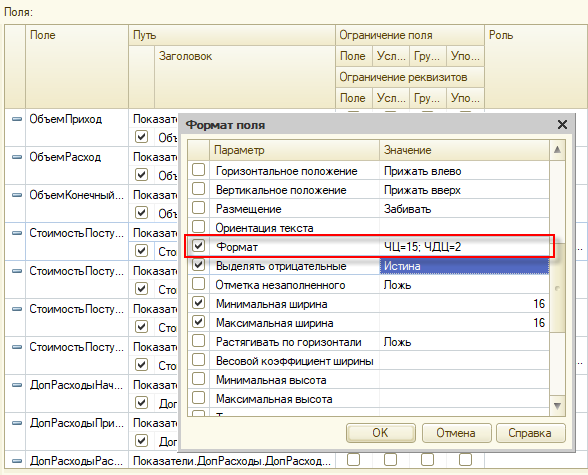
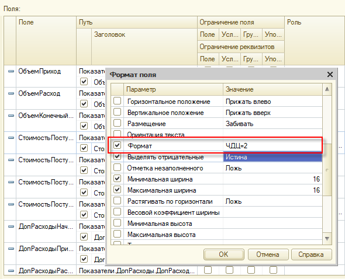

# #std778 Денежные поля: требования по локализации

> Область применения: управляемое приложение, мобильное приложение, обычное приложение.
>
> Раздел ИТС: Требования по локализации
>
> Источник: https://its.1c.ru/db/v8std/content/778/hdoc
>
> Проверено по источнику: 2026-10-07

<a id="1"></a>1\. Для обеспечения работы конфигурации в странах с низким курсом национальной валюты, необходимо предусмотреть увеличение разрядности целой части числовых полей (реквизитов, ресурсов, измерений), содержащих денежный эквивалент – денежные поля. Примеры денежных полей: **Сумма**, **Цена**, **Себестоимость**.

Для этого в метаданных

- для денежных полей, которые могут содержать только положительные значения, вместо фиксированного типа **Число(15, 2)** использовать определяемый числовой тип **ДенежнаяСуммаНеотрицательная**;

- для денежных полей, которые могут содержать отрицательное значение, использовать тип **ДенежнаяСуммаЛюбогоЗнака** со сброшенным флагом **Неотрицательное**.

В тех случаях, когда определяемый тип невозможно указать (например, в качестве типа для параметра формы или включить в составной тип), то следует задать числовой тип максимальной длины - **Число(31, 2)**. При этом в отдельных случаях эта длина должна быть снижена из-за ограничений СУБД, например, в ресурсах регистров.

<a id="2"></a>2\. При использовании в конфигурации **Библиотеки стандартных подсистем** не следует использовать конструктор типа **Число** для получения описания типа денежного поля. Вместо этого использовать функцию, возвращающую описание на основании определяемого типа.

Неправильно:

```bsl
ОписаниеТиповСумма = Новый ОписаниеТипов("Число", Новый КвалификаторыЧисла(15,2));
```

Правильно:

```bsl
ОписаниеТиповСумма = РаботаСКурсамиВалют.ОписаниеТипаДенежногоПоля();
```

<a id="3"></a>3\. При [использовании **ВЫРАЗИТЬ** в текстах запросов](<https://its.1c.ru/db/v8std/content/535/hdoc>) для денежных полей, использовать приведение к типу **ЧИСЛО(31,2)**, что обеспечивает поддержку максимальной длины целой части 29. Ограничение длины целой части 29 обусловлено поддержкой сервера DB2.

Неправильно:

```bsl
ВЫРАЗИТЬ(Т.Сумма / Т.Количество КАК ЧИСЛО(15,2))
```

Правильно:

```bsl
ВЫРАЗИТЬ(Т.Сумма / Т.Количество КАК ЧИСЛО(31,2))
```

<a id="4"></a>4\. При использовании функции **Формат** и при задании формата в свойствах элементов формы, свойствах полей наборов схем компоновки данных и т.д. не следует задавать общую длину.

Неправильно:

```bsl
Формат(Выборка.СуммаДокумента, "ЧЦ=15; ЧДЦ=2")
```

Правильно:

```bsl
Формат(Выборка.СуммаДокумента, "ЧДЦ=2")
```

Неправильно:



Правильно:


