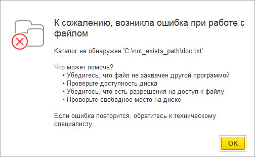
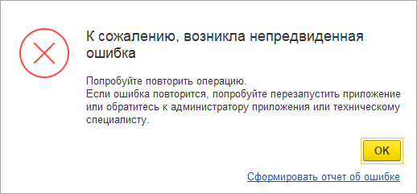
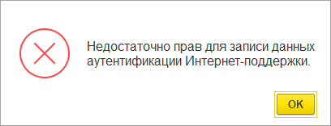
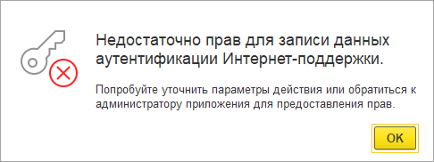

# #std790 Вызов исключений в коде

> Область применения: управляемое приложение, мобильное приложение, обычное приложение.
>
> Раздел ИТС: Соглашения при написании кода / Использование конструкций встроенного языка
>
> Источник: https://its.1c.ru/db/v8std/content/790/hdoc
>
> Проверено по источнику: 2026-10-07

# 1\. В общем случае исключения вызывать не требуется. При возникновении ошибок в работе кода, исключение вызывает платформа и его обрабатывает:

- пользователю выводится сообщение с подходящей рекомендацией;

- в журнал регистрации записывается подробная информация для администратора, включая стек вызовов;

- при необходимости информация отправляется в сервис регистрации ошибок средствами платформы 1С:Предприятие.

Пример № 1. Исключение платформы с категорией ошибки ОшибкаДоступаКЛокальномуФайлу, внешний вид сообщения:



<span style="color: rgb(0,0,0)">Запись журнала регистрации с событием </span><span style="color: rgb(0,0,0)">Ошибка выполнения</span> и комментарием:<br>

 Ошибка при вызове метода контекста (Открыть)<br>

<span style="color: rgb(0,0,0)"> </span>{Обработка.ПримерИсключения.Форма.Форма.Форма(14)}:Текст.Открыть("C:\\not\_exists\_path\\doc.txt");<br>

<span style="color: rgb(0,0,0)"> </span>\[ОшибкаВоВремяВыполненияВстроенногоЯзыка\]<br>

<span style="color: rgb(0,0,0)"> </span>по причине:<br>

<span style="color: rgb(0,0,0)"> </span>Каталог не обнаружен 'C:\\not\_exists\_path\\doc.txt'<br>

<span style="color: rgb(0,0,0)"> </span><span style="color: rgb(0,0,0)">\[ОшибкаДоступаКЛокальномуФайлу\]</span>

Пример №2. Исключение платформы с категорией ошибки ПрочаяОшибка:



Запись журнала регистрации с событием Ошибка выполнения и комментарием:<br>

<span style="color: rgb(0,0,0)"> </span>Поле объекта не обнаружено (Организация)<br>

<span style="color: rgb(0,0,0)"> </span>{Обработка.ПримерИсключения.Форма.Форма.Форма(22)}:Если ЗначениеЗаполнено(Свойства.Организация) Тогда<br>

<span style="color: rgb(0,0,0)"> </span><span style="color: rgb(0,0,0)">\[ОшибкаВоВремяВыполненияВстроенногоЯзыка, ОшибкаИспользованияВстроенногоЯзыка\]</span>

2\. Тем не менее, необходимость вызова исключений в коде все же возникает. При этом для исключений бизнес-логики, которые выводятся пользователю, категорию ошибки указывать не требуется (она соответствует ИсключениеВызванноеИзВстроенногоЯзыка). Для остальных исключений рекомендуется указывать подходящую категорию ошибки: ОшибкаРаботыСПринтером, ОшибкаСети, НарушениеПравДоступа и т.п. В этом случае в сообщении пользователю выводится не только технологический текст ошибки, но и типовые рекомендации по решению проблемы.

Для проверки вывода исключений пользователю рекомендуется запускать 1С:Предприятие без отладки и без режима технического специалиста, т.к. в зависимости от этого в платформе 1С:Предприятие внешний вид и поведение окна исключения различается.<span style="color: rgb(0,0,0)"> </span>

2.1. В большинстве случаев при необходимости выполнить проверку прав доступа следует вызывать метод ВыполнитьПроверкуПравДоступа. Однако в редких случаях, при проверке наличия интересующей роли, исключение следует вызывать программно.

Например, неправильно:

```bsl
Если Не РольДоступна("ПодключениеИнтернетПоддержки") Тогда
    ТекстОшибки = НСтр("ru = 'Недостаточно прав для записи данных аутентификации Интернет-поддержки.'");
    ВызватьИсключение ТекстОшибки;
КонецЕсли;
```

<span style="color: rgb(0,0,0)">Сообщение для пользователя:</span>



<span style="color: rgb(0,0,0)">При этом запись журнала регистрации с событием </span><span style="color: rgb(0,0,0)">Ошибка выполнения</span> и комментарием:<br>

<span style="color: rgb(0,0,0)"> </span>Недостаточно прав для записи данных аутентификации Интернет-поддержки.<br>

<span style="color: rgb(0,0,0)"> </span>{Обработка.ПримерИсключения.Форма.Форма.Форма(32)}:ВызватьИсключение ТекстОшибки;<br>

<span style="color: rgb(0,0,0)"> </span><span style="color: rgb(0,0,0)">\[ОшибкаВоВремяВыполненияВстроенногоЯзыка, ИсключениеВызванноеИзВстроенногоЯзыка\]</span>

Правильно:

```bsl
Если Не РольДоступна("ПодключениеИнтернетПоддержки") Тогда
    ТекстОшибки = НСтр("ru = 'Недостаточно прав для записи данных аутентификации Интернет-поддержки.'");
    ДляАдминистратора = НСтр("ru = 'Нет роли:'") + " " + Метаданные.Роли.ПодключениеИнтернетПоддержки.Представление();
    ВызватьИсключение(ТекстОшибки, КатегорияОшибки.НарушениеПравДоступа,, ДляАдминистратора);
КонецЕсли;
```

<span style="color: rgb(0,0,0)">Сообщение для пользователя:</span>



Автоматическая запись журнала регистрации с событием Ошибка выполнения и комментарием:<br>

<span style="color: rgb(0,0,0)"> </span>Недостаточно прав для записи данных аутентификации Интернет-поддержки.<br>

<span style="color: rgb(0,0,0)"> </span>{Обработка.ПримерИсключения.Форма.Форма.Форма(31)}:ВызватьИсключение(ТекстОшибки, КатегорияОшибки. НарушениеПравДоступа,, ДляАдминистратора);<br>

<span style="color: rgb(0,0,0)"> </span>Нет роли: Подключение Интернет-поддержки<br>

<span style="color: rgb(0,0,0)"> </span><span style="color: rgb(0,0,0)">\[НарушениеПравДоступа, ОшибкаВоВремяВыполненияВстроенногоЯзыка, ИсключениеВызванноеИзВстроенногоЯзыка\]</span>

2.2. Для диагностики программных ошибок, например, когда из вызывающего кода передано некорректное значение входного параметра, некорректно встроена подсистема и т.п., рекомендуется вызывать исключение с категорией ОшибкаКонфигурации. Такие ошибки предназначены для разработчиков, а не для пользователей; они выявляются и исправляются при отладке и тестировании продукта. В этом случае выводится стандартное сообщение «К сожалению, возникла непредвиденная ошибка» с предложением сформировать отчет об ошибке и отправить его разработчику.

Пример:

```bsl
Если ТипЗнч(Количество) <> Тип(«Число») Тогда
    ТекстОшибки = НСтр("ru = 'Недопустимое значение параметра'") + " " + "Количество";
    ВызватьИсключение(ТекстОшибки, КатегорияОшибки.ОшибкаКонфигурации);
КонецЕсли;
```

<span style="color: rgb(0,0,0)">Сообщение:</span>


<span style="color: rgb(0,0,0)">Запись журнала регистрации с событием </span><span style="color: rgb(0,0,0)">Ошибка выполнения</span> и комментарием:<br>

<span style="color: rgb(0,0,0)"> </span>Недопустимое значение параметра Количество<br>

<span style="color: rgb(0,0,0)"> </span>{Обработка.ПримерИсключения.Форма.Форма.Форма(40)}:ВызватьИсключение(ТекстОшибки, КатегорияОшибки.ОшибкаКонфигурации);<br>

<span style="color: rgb(0,0,0)"> </span><span style="color: rgb(0,0,0)">\[ОшибкаВоВремяВыполненияВстроенногоЯзыка, ИсключениеВызванноеИзВстроенногоЯзыка, ОшибкаКонфигурации\]</span>

2.3. В тех случаях, когда анализ типов исключений важен для корректной работы бизнес-логики, следует выбрать один из трех вариантов:

- отказаться от вызова исключений и возвращать строковые коды ошибок (коды возврата). При этом недопустимо использовать числовые коды ошибок, т.к. код становится нечитаемым; строковые литералы кодов ошибок не локализуются.

- анализировать подходящую категорию ошибки в исключении, которое вызвано в методе платформы;

- вызывать исключение, указывая в методе ВызватьИсключение строковый код ошибки в третьем параметре Код. Этот вариант подходит, если вернуть код ошибки затруднительно, например, когда ошибка возникает в обработчиках событий ПередЗаписью, ПриЗаписи и т.п. или когда пробросить код ошибки на самый верх большого стека вызовов неоправданно сложно.

2.3.1. Пример обработки кодов ошибок вместо вызова исключения:

```bsl
РезультатЗагрузки = ЗагрузитьФайлИзИнтернета(...);
Если РезультатЗагрузки = "Успешно" Тогда
...
ИначеЕсли ...
```

<span style="color: rgb(0,0,0)">2.3.2. Пример анализа категории ошибки в исключении, которое вызвано в методе платформе:</span>

```bsl
НомерПопытки = 1;
Пока НомерПопытки < 4 Цикл
    Попытка
        HTTPОтвет = HTTPСоединение.ОтправитьДляОбработки(HTTPЗапрос);
    Исключение
        ИнформацияОбОшибке = ИнформацияОбОшибке();
        Если ИнформацияОбОшибке.ЯвляетсяОшибкойКатегории(КатегорияОшибки.ОшибкаСети) Тогда
            НомерПопытки = НомерПопытки + 1;
            Продолжить;
        КонецЕсли;
        ВызватьИсключение;
    КонецПопытки;
КонецЦикла;
```

<span style="color: rgb(0,0,0)">2.3.3. Пример вызова метода </span><span style="color: rgb(0,0,0)">ВызватьИсключение</span><span style="color: rgb(0,0,0)"> со строковым кодом ошибки:</span>

```bsl
Если КонфигурацияБазыДанныхИзмененаДинамически() Тогда
    ВызватьИсключение(НСтр("ru = 'Версия приложения обновлена, требуется перезапустить сеанс.'"),,
        "СтандартныеПодсистемы.БазоваяФункциональность.КонфигурацияИзмененаДинамически");
КонецЕсли;
```

Для уникальности кодов ошибок в них рекомендуется включать префикс подсистемы, в которой вызывается исключение, например:<br>

"СтандартныеПодсистемы.БазоваяФункциональность.КонфигурацияИзмененаДинамически",<br>

<span style="color: rgb(0,0,0)">"СтандартныеПодсистемы.БазоваяФункциональность.РасширенияИзмененыДинамически".</span>

Пример обработки исключения со строковым кодом ошибки:

```bsl
Попытка
    ВыполнитьОбновление();
Исключение
    КодОшибки = ИнформацияОбОшибке().Код;
    Если КодОшибки = "СтандартныеПодсистемы.БазоваяФункциональность.КонфигурацияИзмененаДинамически"
     Или КодОшибки = "СтандартныеПодсистемы.БазоваяФункциональность.РасширенияИзмененыДинамически" Тогда
        ПерезапуститьЗаданиеОбновления();
        Возврат;
    КонецЕсли;
    ВызватьИсключение;
КонецПопытки;
```

При использовании в конфигурации Библиотеки стандартных подсистем (БСП) для обработки кодов ошибок в исключениях рекомендуется вызывать функцию ЭтоИсключениеСКодомОшибки общего модуля ОбщегоНазначенияКлиентСервер. Она находит один или несколько интересующих кодов ошибок рекурсивно во всех вложенных исключениях (в свойстве ИнформацияОбОшибке.Причина), что удобно, когда исключение перевызывается по стеку. Пример:

```bsl
Попытка
    ВыполнитьОбновление();
Исключение
    Если ОбщегоНазначенияКлиентСервер.ЭтоИсключениеСКодомОшибки(ИнформацияОбОшибке(),
            "СтандартныеПодсистемы.БазоваяФункциональность.КонфигурацияИзмененаДинамически
            |СтандартныеПодсистемы.БазоваяФункциональность.РасширенияИзмененыДинамически") Тогда
        ПерезапуститьЗаданиеОбновления();
        Возврат;
    КонецЕсли;
    ВызватьИсключение;
КонецПопытки;
```

3\. Неприемлемо в событиях ОбработкаПроверкиЗаполнения, ОбработкаПроведения, ПередЗаписью, ПриЗаписи, ПередУдалением и т.п. вызывать исключения для выдачи останавливающих предупреждений, которые должен отработать пользователь. Вместо этого следует устанавливать параметр Отказ в значение Истина и выводить сообщения пользователю. Тем самым пользователь увидит все блокирующие причины остановки сразу, а не по очереди.

Но если пользователь не может отработать останавливающее предупреждение в рамках выполняемой операции или ошибочная ситуация носит исключительный характер и делает бессмысленными все остальные проверки, которые выводят другие предупреждения, то следует вызывать исключение.

```bsl
Процедура ПередЗаписью(Отказ)
    Если Не ЗарегистрироватьИзмененияНаУзлахПлановОбмена() Тогда
        ТекстОшибки = НСтр("ru = 'Не удалось зарегистрировать изменения на узлах планов обмена. Обратитесь к администратору.'");
        ВызватьИсключение ТекстОшибки;
    КонецЕсли;
      ...
КонецПроцедуры
```

Подробнее см. пп. 1.1 и 1.3 стандарта [Информирование пользователя](<https://its.1c.ru/db/v8std/content/400/hdoc>)<span style="color: rgb(0,0,0)">.</span>
