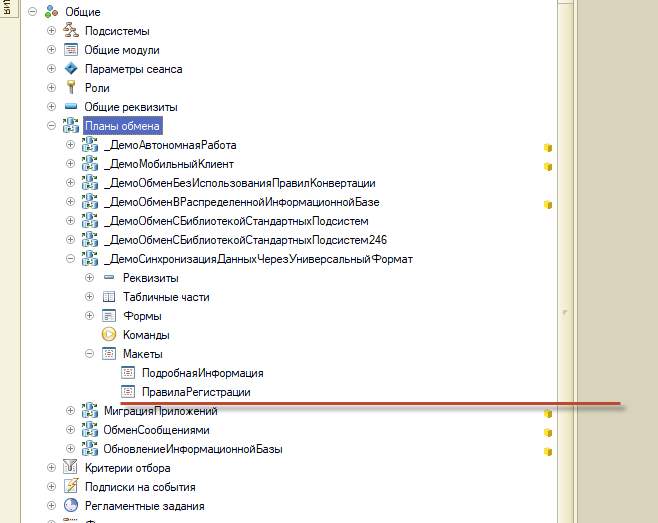
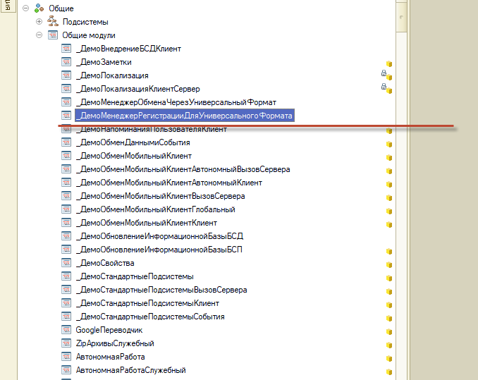

# #std799 Разработка правил регистраций

> Область применения: управляемое приложение, мобильное приложение.
>
> Раздел ИТС: Реализация обмена данными
>
> Источник: https://its.1c.ru/db/v8std/content/799/hdoc
>
> Проверено по источнику: 2026-10-07

**Правила регистрации** – алгоритмы, где описываются проверки, фильтры и отборы данных, которые участвуют в синхронизации данных (обменах). Под данными подразумеваются ссылочные и не ссылочные объекты.

1\. Правила регистрации следует размещать в модулях конфигурации, например, поставлять в виде общего модуля **(менеджера регистрации)**. Поставка кода правил регистрации в модулях:

- позволяет включить правила регистрации во все типовые и дополнительные проверки, например, синтаксис при помощи платформы;

- позволяет автоматизировать выпуск исправлений и отслеживание их применимости;

- упрощает отладку кода (не требуется подключать внешние обработки отладки);

- сокращает затраты на автоматический перевод кода и выпуск WE версий приложений;

- повышает читаемость алгоритмов и процедур-событий правила регистрации.

### Например, неправильно:

### Правильно:

2\. В правилах регистрации в целях безопасности и повышения отказоустойчивости кода следует избегать изменение безопасного или привилегированного режима, так же запрещается использовать методы (конструкции), которые изменяют **Привилегированный** и **Безопасный** режимы работы 1С:Предпрития;

3\. Исправление ошибок в правилах обмена необходимо поставлять в виде **расширений (патчей)**.

### См. также

- [Описание инструмента "Конвертация данных"](<https://its.1c.ru/db/metod8dev/content/2943/hdoc>) в разделе "Методическая поддержка 1С:Предприятия 8"

- ["Разработка правил регистрации"](<https://its.1c.ru/db/bsp321doc/content/4/hdoc/issogl3_правила_регистрации>) в разделе "Инструкции по разработке на 1С"
